# PROJECT HANDOVER CONTEXT

## Phase 8.2C — Safety case integration audit (2026-11-13)

The Alert Register had not yet been converted when audited: it still called the
individual-alert endpoint and the reported case components were absent. The
existing route now consumes the Phase 8.2A safety-case list/detail APIs and has
case cards, filters, a modal-focus investigation drawer, child `AlertRow`
actions, evidence and assessment/correction lineage, backend counts, and
`#incidents` finding links. Lifecycle calls continue to address one
`alert_id`; no bulk case action exists. The `/safety-cases` Vite proxy and
meaningful non-JSON error handling were added.

Isolated validation: backend 219 passed / 9 PostgreSQL tests skipped; frontend
build passed; lint passed with six pre-existing warnings; no frontend test
script exists; `git diff --check` passed. Authenticated read-only before/after
snapshots were unchanged (27 observations; 13 alerts, IDs 3–15; Open 5,
Acknowledged 1, Resolved 5, Dismissed 2). The live backend's OpenAPI does not
expose the safety-case paths, and the proxied case request returns 404 although
the checked-out source contains the routes. The backend was not restarted.
The paired authenticated snapshots matched; a subsequent read-only request
received 401 after browser session expiry, and no reauthentication was attempted.
Populated case/drawer connected checks remain pending; do not sign off the
combined 8.2A/B/C checkpoint until the backend is reloaded from this workspace
and that read-only verification passes. See
[phase-8-2c-integration-audit.md](docs/phase-8-2c-integration-audit.md).

## Phase 8.2A — Observation-level safety cases (2026-11-13)

The architecture audit chose a backward-compatible read-time grouping: one
virtual case per observation with at least one alert, keyed as
`observation:<observation_id>`. The alert table, existing alert IDs and lifecycle
rows remain authoritative; no schema migration or case-level write endpoint is
introduced. The design and contract are in
[phase-8-2a-safety-cases.md](docs/phase-8-2a-safety-cases.md).

Authenticated APIs: `GET /safety-cases` filters by exact work area, derived case
status, timezone-aware half-open observed-at range, case/observation ID search,
sort, and case pagination; `GET /safety-cases/{observation_id}` returns all
related child alerts, detected findings and assessment history, correction
lineage, Phase 8.1D overall risk, and original/annotated evidence availability.
`total_cases` counts unique observations; `total_alerts` counts child alerts
across the filtered result before pagination. A case is Open if any child is
Open, otherwise Acknowledged if any child is Acknowledged; it is Resolved only
when all children are Resolved, Dismissed only when all are Dismissed, and
`mixed_closed` for remaining mixed closed states. Unresolved means Open or
Acknowledged. Existing individual Safety Officer/Admin alert lifecycle APIs
remain unchanged.

Frontend types and `fetchSafetyCases` / `fetchSafetyCase` client helpers are
available for Phase 8.2B; Alert Register UI remains unchanged. Full isolated
backend suite: 219 passed, nine PostgreSQL tests skipped with the test database
unset. Frontend build passed; lint passed with seven existing warnings;
`git diff --check` passed. Related graphs are eagerly loaded to avoid N+1 reads,
but the initial grouping materializes candidate alerts in application memory;
replace with SQL aggregation if deployment volume requires it. No saved data,
schema, risk policy, alert records, evidence, model weights, or baseline branch
was changed. No staging or commit was performed.

Latest Phase 8.1D connected sign-off: authenticated browser verification
completed at `http://127.0.0.1:5173`. The earlier login-screen blocker was
resolved by consistently using the authenticated `127.0.0.1` origin; `localhost`
is a separate origin. Read-only checks confirmed the overall risk cards,
individual findings, risk facets, evidence, and responsive navigation. Before/
after API snapshots found 27 observations and 13 alerts unchanged. An all-Pending
observation was unavailable in live data and remains covered by isolated tests.
See the progress log and assessment API contract for details.

## Phase 8.1D overall observation risk aggregation — 2026-11-13

Observation detail and query items now expose a derived overall summary. It
selects the latest assessment per finding, takes the maximum valid completed
score, and uses the existing authoritative risk-band function. Risk tabs/facets
remain existential per-individual-finding filters for compatibility. Mixed
completed/Pending results carry a provisional overall maximum; all-Pending,
incomplete/malformed, and no-supported-finding observations expose null score
and explicit statuses. The collapsed Safety Incidents row shows one overall
risk classification; expanded finding scores, correction/audit history, alert
policy and decision semantics remain independent and unchanged. See the
[assessment API contract](docs/phase-8-1a-assessment-contracts.md#phase-81d-observation-level-risk-summary).
Automated regression: 213 isolated backend tests pass; nine PostgreSQL
integration tests skipped because TEST_DATABASE_URL was unset. Frontend
build/TypeScript and lint pass (seven existing warnings), and `git diff --check`
passes. Authenticated connected verification and read-only saved-record
comparison are complete as recorded below. Isolated tests did not touch saved
local/demo records. No Phase 8.2 work was performed.

## Phase 8.1A current update — 2026-11-09

Multi-Pending follow-up: analysis now keeps the persisted observation card and
evidence mounted across completion, automatically focuses the next Pending form,
retains confirmed scores/drafts, and withholds the final decision until no current
findings remain Pending. A session-scoped observation ID restores analysis from
backend data after refresh; history deep links also recover remaining work.
History completion refreshes in the background. Client submission guards complement
existing backend conflict/duplicate protection. No scoring/alert/backend production
changes. Recorded context still cannot be replaced through completion: use the
existing Edit Context workflow for corrections. 59 isolated backend tests and
build/typecheck/lint pass (seven existing warnings). Isolated browser fixture
verified sequential completion/reload/draft and evidence retention; real #50/#51
were inspected read-only and all 26 observations / 13 alerts stayed unchanged.

Latest Phase 8.1C correction update (2026-11-09): all four UI fixes are implemented.
Shared modal focus containment/inert background handling supports image previews
and mobile navigation; desktop sidebar behavior is retained. Deep links validate
assessment membership, report missing/mismatched targets, and offer return to
history. Off-page targets occupy a separately labeled section outside the
unchanged paginated results; hash removal clears supplemental/expanded state and
obsolete asynchronous lookups are ignored. Historical assessment targets render
the exact assessment without exposing historical edit controls.
58 isolated backend tests and frontend build/typecheck pass; lint passes with
seven existing warnings, and diff whitespace checks pass. Final authenticated
post-fix checks now pass: both evidence variants and keyboard focus lifecycle,
mobile/tablet navigation, valid/missing/mismatched links, clearing/Back/Forward,
pagination and duplication, all risk filters, thumbnails and desktop sidebar.
Current baseline is 26 observations (one Pending) and 13 alerts; full query and
alert responses matched before/after. Phase 8.1A/B/C is ready for a Git checkpoint,
subject to the documented coverage limits. No saved records or Git history changed.
See the latest status in [verification](docs/phase-8-1c-verification.md).

Previous Phase 8.1C verification update (2026-11-09): **connected pass completed with four
confirmed frontend defects**. Authentication was restored; 25 observations and
13 alerts were independently checked read-only and remained unchanged. Filters,
search, area/dates, sorting, pagination, image previews, valid off-page deep links,
sidebar controls and sampled responsive geometry passed. Image-modal keyboard
handling, mobile hidden-menu focus/Escape, silent invalid assessment links and
stale pinned observations remain defective. 58 isolated tests, build/typecheck
and lint pass (seven existing warnings). Non-empty Pending and review-required
live states are absent and remain unverified; their logic has isolated coverage.
No production code or saved data changed. Fix/recheck the four findings before a
clean A/B/C checkpoint; see the [final matrix](docs/phase-8-1c-verification.md).

Development remains on `revamp/milestone-2`; the initial working tree was clean.
The preserved baseline branch/tag were not modified, and no staging, commits or
other Git mutations were performed. See the authoritative
[assessment API and Antigravity contract](docs/phase-8-1a-assessment-contracts.md).

New authenticated `/observation-query` supports independent current-assessment
bands/Pending, exact area and observation ID, half-open timezone-aware dates,
stable newest/oldest ordering, pagination and full-filter-set counts. Mixed-risk
observations retain every finding; the overall decision is not a filter proxy.
`GET /assessments/{id}` provides effective context, revision, correction audit and
reconciliation state. Officer/Admin `PATCH /assessments/{id}/context` corrects
people exposed, minutes and scoring repetition using unchanged scoring/decision
rules, an observation lock and stale-revision rejection. Corrections are atomic,
do not rerun YOLO, and do not alter image evidence or sibling scores.

Existing observation metadata stores per-assessment context, append-only
correction history and pre-correction alert snapshots. Existing alert rows and
lifecycle are preserved. Alert APIs distinguish historical assessment from
`current_assessment` and expose `review_required`. Eligible new alerts use the
existing policy and deduplication; pending siblings still defer new alerts.
Review flags are intentionally sticky pending a separately designed review flow.

Frontend types/client helpers, a minimal context editor/audit view, alert review
notice and `#incidents?observation_id=...&assessment_id=...` navigation are present.
Filter parameters survive in the link for the future UI; existing aliases work.
No visual redesign was started. Full-filter aggregation currently runs in memory;
PostgreSQL concurrency and connected-browser verification remain limitations.
Validation: backend 209 tests run, nine PostgreSQL skips; eight focused tests
passed; frontend build/typecheck passed, lint passed with six existing warnings.
See the [progress log](docs/milestone-2-progress-log.md) for details.

**Agentic AI for Safety Monitoring with Construction Risk Analytics**

> [!NOTE]
> This document is a self-contained technical handover for a new lead AI to
> direct development. It was generated from the repository on branch
> `feature/safety-agent-visual-test` (2026-11-04), updated after Milestone 2
> Phase 7A and the subsequent connected local verification on 2026-11-06. Source files are authoritative; code snippets below are explanatory.

---

## Table of Contents

1. [Project Overview & Directory Structure](#1-project-overview--directory-structure)
2. [Architecture & Agentic Workflow](#2-architecture--agentic-workflow)
3. [Milestone 1 Foundation & Current API](#3-milestone-1-foundation--current-api)
4. [Milestone 2 Workspace & Current State](#4-milestone-2-workspace--current-state)
5. [Key Code Snippets & Schemas](#5-key-code-snippets--schemas)

---

## 1. Project Overview & Directory Structure

### 1.1 Directory Tree

```text
agentic-construction-risk-analytics/
├── .env                              # Local env vars (DATABASE_URL, etc.) — gitignored
├── .gitignore
├── alembic.ini                       # Alembic migration config
├── README.md                         # Project README with run/test instructions
├── requirements.txt                  # Core runtime deps (FastAPI, SQLAlchemy, LangGraph…)
├── requirements-dev.txt              # Adds httpx for test client
├── requirements-ml.txt               # Adds ultralytics, torch, torchvision, pillow
├── diagnose_yolo.py                  # Standalone YOLO diagnostic script
├── test_safety_real_image.py         # Top-level real-image smoke test
│
├── alembic/
│   ├── env.py                        # Alembic environment setup
│   ├── script.py.mako                # Migration template
│   └── versions/
│       ├── 0001_initial_schema.py    # Initial DB migration (6 tables)
│       ├── 0002_user_accounts.py     # Persisted user accounts and roles
│       └── 0003_alert_dismissed_at.py # Nullable alert dismissal timestamp
│
├── backend/
│   ├── app/
│   │   ├── __init__.py
│   │   ├── main.py                   # FastAPI app — all API endpoints
│   │   ├── models.py                 # Immutable dataclasses (NormalizedObservation, etc.)
│   │   ├── scoring.py                # Risk formula: severity × likelihood × exposure
│   │   ├── risk_agent.py             # SiteRiskAgent — rule-based hazard detection & scoring
│   │   ├── safety_agent.py           # SafetyAgent — YOLO model loading, inference, assessment
│   │   ├── decision_engine.py        # Shared four-outcome safety decision policy
│   │   ├── safety_graph.py           # LangGraph state machine for routing safety results
│   │   ├── analytics.py              # Persisted PPE metrics grouped by work_area
│   │   ├── auth.py                   # Authentication and role dependencies
│   │   ├── bootstrap_admin.py        # First-admin operator bootstrap
│   │   ├── detector.py               # Label normalization, BaseHazardDetector hierarchy
│   │   ├── db_models.py              # SQLAlchemy ORM (Observation, DetectedHazardRecord, etc.)
│   │   ├── database.py               # Engine/session factory, get_db dependency
│   │   ├── persistence.py            # Atomic observation+hazard+assessment persistence
│   │   ├── image_storage.py          # File-backed image storage for observations
│   │   └── utils/
│   │       └── draw.py               # Bounding-box annotation onto images (PIL)
│   │
│   └── tests/
│       ├── __init__.py
│       ├── test_api.py               # POST /assessments endpoint tests
│       ├── test_alert_api.py         # Alert lifecycle API tests
│       ├── test_auth.py              # Authentication and role tests
│       ├── test_database.py          # Engine/session/connection tests
│       ├── test_decision_engine.py   # Shared decision policy tests
│       ├── test_database_integration.py  # Live PostgreSQL integration (skipped w/o TEST_DATABASE_URL)
│       ├── test_experimental_safety.py   # /experimental/safety/detect endpoint tests
│       ├── test_image_assessment.py      # POST /assessments/image endpoint tests
│       ├── test_image_persistence.py     # Image storage + retrieval tests
│       ├── test_observation_api.py       # GET /observations endpoint tests
│       ├── test_persistence.py           # Persistence layer unit tests
│       ├── test_risk_agent.py            # SiteRiskAgent logic tests
│       ├── test_safety_file.py           # Safety agent file-based tests
│       ├── test_safety_graph.py          # LangGraph routing tests
│       ├── test_yolo_detector.py         # YOLOv8HazardDetector adapter tests
│       ├── test_zone_analytics.py        # Persisted zone-analytics tests
│       └── test_recurrence_analytics.py  # Distinct-observation recurrence tests
│
├── frontend/
│   └── src/
│       ├── App.tsx                    # Authenticated app shell and sections
│       ├── main.tsx                   # React entry point
│       ├── index.css                  # Global styles (Tailwind)
│       ├── api/
│       │   └── client.ts             # Backend HTTP client with bearer token
│       ├── auth/                     # Login, signup, session context
│       ├── components/
│       │   ├── AppShell.tsx           # Sidebar, header, responsive navigation
│       │   ├── OverviewPage.tsx       # Backend-backed overview
│       │   ├── AlertsPage.tsx         # Role-aware alert lifecycle view
│       │   ├── ZoneAnalyticsPage.tsx # work_area analytics view
│       │   ├── Navbar.tsx             # Existing navigation component
│       │   ├── OverviewCards.tsx      # KPI summary cards
│       │   ├── ImageUploader.tsx      # Drag-and-drop image upload for assessment
│       │   ├── AssessmentResults.tsx  # Risk assessment display
│       │   ├── SafetyDecisionPanel.tsx # Shared four-outcome decision presentation
│       │   ├── ObservationHistory.tsx # Persisted observation list
│       │   └── ExperimentalSafetyViewer.tsx  # Experimental YOLO + SafetyAgent viewer
│       ├── types/
│       │   └── index.ts              # TypeScript interfaces mirroring backend schemas
│       └── utils/
│           └── formatters.ts         # Display formatting helpers
│
├── data/                             # Runtime data (observation images) — gitignored
├── datasets/                         # Raw/supplementary datasets — gitignored
├── diagnostics/                      # YOLO diagnostic outputs
├── docs/
│   ├── milestone-1-foundation.md     # Milestone 1 design doc + scoring formula
│   ├── milestone-2-progress-log.md   # Living progress log for Milestone 2
│   └── safety-graph.md              # LangGraph routing documentation
├── notebooks/                        # Jupyter notebooks (training, exploration)
├── reports/
│   └── milestone-2/
│       └── milestone-2-requirement-audit.md
├── runs/                             # YOLO prediction output images
│   └── detect/
│       ├── predict/
│       ├── predict-2/
│       └── predict-3/
├── scripts/
│   └── start_backend_yolo.ps1        # Launch FastAPI with YOLO model
└── weights/
    └── best.pt                       # Trained YOLOv8n checkpoint — gitignored
```

### 1.2 Module Descriptions

| Module / Folder | Purpose |
|---|---|
| `backend/app/main.py` | FastAPI application. Defines all API endpoints, Pydantic request/response models, image payload extraction, and dependency injection for detector and database session. |
| `backend/app/models.py` | Immutable frozen dataclasses: `NormalizedObservation`, `DetectedHazard`, `HazardAssessment`. These are the core domain objects passed between agents. |
| `backend/app/risk_agent.py` | `SiteRiskAgent` — rule-based agent mapping observation labels to hazard types (`LABEL_TO_HAZARD`) and computing risk scores using severity/likelihood/exposure lookup tables. |
| `backend/app/scoring.py` | Pure scoring functions: `calculate_risk_score(S, L, E) = S × L × E`, `risk_band()` maps scores 1–100 to Low/Moderate/High/Critical. |
| `backend/app/safety_agent.py` | Safety Agent loads YOLO, runs inference, builds `SafetyAssessment` with raw evidence, and delegates `decide_alert` to the shared policy. `AlertDecision` aliases `SafetyDecision`. |
| `backend/app/decision_engine.py` | Pure deterministic four-outcome policy returning reason, risk band, notification priority, evidence and provisional policy version; risk scoring is unchanged. |
| `backend/app/safety_graph.py` | LangGraph consumes the shared decision for review/no-finding/pending routing without database or notification side effects. |
| `backend/app/analytics.py` | Database-backed PPE violation, risk-band and alert aggregates using `work_area` as free text; read-only named-work-area recurrence counts distinct observations separately from existing hazard-row totals. |
| `backend/app/auth.py` | Persisted users, scrypt password hashing, JWT authentication and role dependencies. |
| `backend/app/detector.py` | Detector adapter hierarchy: `BaseHazardDetector` (ABC) → `YOLOv8HazardDetector`, `MockHazardDetector`, `UnconfiguredHazardDetector`. Also contains label normalization (`normalize_detection_label`) and the Roboflow class mapping. |
| `backend/app/db_models.py` | SQLAlchemy ORM: `Observation`, `DetectedHazardRecord`, `RiskAssessment`, `SafetyRecommendation`, `Alert`, `AgentWorkflowRun`, `UserAccount`. PostgreSQL-specific (JSONB, ARRAY, UUID). |
| `backend/app/database.py` | Database engine creation, session factory, `get_db` FastAPI dependency. Loads `.env` via `python-dotenv`. Yields `None` when `DATABASE_URL` is unset. |
| `backend/app/persistence.py` | Atomically persists observation, hazards, assessments, evidence and shared decision metadata; creates only policy-actionable new alerts. Phase 6B completes existing pending assessments using the same scorer and policy, stores audit metadata, and serializes competing completions by Observation lock. Historical alerts are not rewritten. |
| `backend/app/image_storage.py` | File-backed image persistence under `data/observations/`. SHA-256 keyed. Stores original + annotated variants. |
| `backend/app/utils/draw.py` | PIL-based bounding-box annotation. Returns base64-encoded PNG. |
| `frontend/` | React + TypeScript + Vite + Tailwind CSS SafeSite shell with login/signup, Overview, Safety Incidents, Alerts, Zone Analytics and AI Safety Analysis. |
| `alembic/` | Database migrations: `0001_initial_schema` creates six initial tables; `0002_user_accounts` adds persisted users; `0003_alert_dismissed_at` adds a nullable dismissal timestamp. Phase 6B required no new migration and forward-upgraded the preserved demo database to head `0003_alert_dismissed_at` after disposable verification. |
| `scripts/start_backend_yolo.ps1` | Convenience launcher: activates `.venv-yolo`, resolves weights, disables YOLO auto-install, starts Uvicorn. |
| `weights/best.pt` | Trained YOLOv8n checkpoint on Roboflow Construction Site Safety (25 classes). Gitignored. |

---

## 2. Architecture & Agentic Workflow

### 2.1 System Architecture

```mermaid
flowchart TD
    subgraph Frontend["Frontend (React + Vite)"]
        UI["SafeSite shell / Auth / Overview / Incidents / Alerts / Zones / Analysis"]
    end

    subgraph API["FastAPI (backend/app/main.py)"]
        Health["GET /health"]
        AssessJSON["POST /assessments"]
        AssessImg["POST /assessments/image"]
        ObsList["GET /observations"]
        ObsDetail["GET /observations/{id}"]
        ObsImage["GET /observations/{id}/image/{variant}"]
        ExpDetect["POST /experimental/safety/detect"]
        AlertAPI["GET/PATCH /alerts"]
        ZoneAPI["GET /analytics/zones"]
        AuthAPI["/auth/signup /auth/login /auth/me"]
    end

    subgraph Agents["Agentic Layer"]
        RiskAgent["SiteRiskAgent\n(rule-based)"]
        SafetyAgent["SafetyAgent\n(YOLO + assessment)"]
        SafetyGraph["SafetyGraph\n(LangGraph routing)"]
        Decision["Shared Safety Decision Engine\n(provisional policy)"]
    end

    subgraph Detection["Detection Layer"]
        Detector["BaseHazardDetector"]
        YOLO["YOLOv8HazardDetector"]
        Mock["MockHazardDetector"]
        Unconfig["UnconfiguredHazardDetector"]
    end

    subgraph Storage["Persistence Layer"]
        DB[(PostgreSQL)]
        ImgStore["File Storage\n(data/observations/)"]
        ORM["SQLAlchemy ORM\n(db_models.py)"]
    end

    UI -->|HTTP| API
    AssessJSON --> RiskAgent
    AssessImg --> Detector
    Detector --> YOLO
    Detector --> Mock
    Detector --> Unconfig
    AssessImg --> RiskAgent
    ExpDetect --> SafetyAgent
    SafetyAgent -->|"load_model()"| YOLO
    SafetyAgent --> RiskAgent
    AssessJSON --> Decision
    AssessImg --> Decision
    SafetyAgent --> Decision
    Decision --> SafetyGraph
    ExpDetect --> SafetyGraph
    RiskAgent -->|"HazardAssessment"| API
    AssessJSON -->|"persist_observation_bundle"| ORM
    AssessImg -->|"persist_observation_bundle"| ORM
    AssessImg -->|"save_observation_images"| ImgStore
    AlertAPI --> ORM
    ZoneAPI --> ORM
    AuthAPI --> ORM
    ORM --> DB
```



### 2.2 Agent Descriptions

#### SiteRiskAgent (`risk_agent.py`)
- **Type:** Deterministic, rule-based. No LLM.
- **Input:** `NormalizedObservation` (labels, people_count, duration_minutes, repeated_count).
- **Process:** Maps labels → hazard types via `LABEL_TO_HAZARD`, computes severity/likelihood/exposure from lookup tables, multiplies for `risk_score`, maps to `risk_band`.
- **Output:** Detected hazards and zero or more `HazardAssessment` objects; `assess_hazard` returns `None` when required inputs are incomplete.

#### SafetyAgent (`safety_agent.py`)
- **Type:** Vision-based agent. No LLM.
- **Input:** `detect_objects` takes an image file path and model; `assess_safety` takes `DetectionResult` plus optional `NormalizedObservation`. The endpoint accepts image bytes.
- **Process:** Loads YOLO checkpoint → runs inference → normalizes class labels → maps to `DetectedHazard` → links raw evidence (`SafetyHazardEvidence`) → optionally scores with `SiteRiskAgent` → builds recommendations → delegates decision to `evaluate_safety_decision`.
- **Output:** `SafetyAssessment` (detections, hazards, evidence, assessments, recommendations) and shared `SafetyDecision` (`AlertDecision` compatibility alias).

#### Shared Safety Decision Engine (`decision_engine.py`)
- **Type:** Pure, deterministic provisional notification policy; it does not score risk, persist, or notify.
- **Input:** Explicit supported findings, their completed assessments, and detection-completeness flag.
- **Output:** `alert`, `warning`, `no_alert`, or `pending`, with reason, risk band, notification priority, evidence per finding, and policy version. Missing or inconsistent scoring is `pending`; no supported finding is not proof of safety.

#### SafetyGraph (`safety_graph.py`)
- **Type:** LangGraph `StateGraph` — conditional routing. No LLM.
- **Input:** `SafetyAssessment` + shared decision from SafetyAgent (or graph computes it from a valid assessment if omitted).
- **Process:** `_prepare_assessment` → `decide_route` → one of three terminal nodes.
- **Output:** `SafetyState` dict with `routing_decision`, `routing_status`, `routing_reason`.
- **Routing outcomes:**
  - `safety_review_required` — policy `alert` or `warning`; human review, not notification delivery.
  - `no_supported_ppe_violations` — policy `no_alert` on a completed assessment; not confirmed safety.
  - `assessment_pending` — policy `pending` or invalid/incomplete input.

### 2.3 Agent Framework

| Framework | Version | Usage |
|---|---|---|
| **LangGraph** | ≥1.2.18 | `SafetyGraph` state machine for routing safety assessment outcomes. Used in the experimental endpoint. |

> [!IMPORTANT]
> The project is **entirely rule-based**. No LLMs (Gemini, OpenAI, etc.) are
> used anywhere. No prompt templates exist. The `SiteRiskAgent` uses
> deterministic lookup tables; the `SafetyAgent` uses YOLO object detection;
> the `SafetyGraph` uses LangGraph purely for conditional state routing.

### 2.4 Inter-Agent Communication

Agents communicate through **direct Python function calls** with immutable dataclass objects:

1. **Standard detector** → `DetectorResult` with hazard labels, person count and boxes; experimental `detect_objects` → `DetectionResult` with raw detections.
2. **SiteRiskAgent** → consumes `NormalizedObservation`, produces detected hazards and optional `HazardAssessment` values.
3. **Shared decision engine** → consumes supported findings and available assessments from either path, returns `SafetyDecision`.
4. **SafetyAgent** → consumes experimental `DetectionResult` and optional observation, produces `SafetyAssessment`; `decide_alert` delegates to the shared engine.
5. **SafetyGraph** → consumes the assessment and shared decision, produces `SafetyState` routing dict without side effects.

There is no message queue, event bus, or async inter-agent protocol. The FastAPI endpoint orchestrates the pipeline sequentially.

### 2.5 External Dependencies & Integrations

| Dependency | Role |
|---|---|
| **FastAPI** + **Uvicorn** | HTTP API server |
| **SQLAlchemy** ≥2.0 + **psycopg** ≥3.0 | PostgreSQL ORM and connectivity |
| **Alembic** ≥1.13 | Database schema migrations |
| **Pillow** ≥10.0 | Image decoding, bounding-box annotation |
| **python-dotenv** ≥1.0 | `.env` file loading |
| **LangGraph** ≥1.2.18 | State-machine graph for safety routing |
| **Ultralytics** ≥8.0 (optional) | YOLOv8 model loading and inference |
| **PyTorch** ≥2.0 + **torchvision** ≥0.15 (optional) | YOLO inference backend |
| **httpx** (dev only) | FastAPI `TestClient` |

**Database:** PostgreSQL (configured via `DATABASE_URL`). Persisted account, alert, observation and analytics operations require it; the experimental inference route itself does not write observations or alerts.

**Vision Model:** YOLOv8n trained on Roboflow Construction Site Safety (25 classes). Checkpoint at `weights/best.pt`. Supports 3 explicit violation classes: `NO-Hardhat`, `NO-Safety Vest`, `NO-Mask`.

---

## 3. Milestone 1 Foundation & Current API

### 3.1 API Endpoints

All endpoints are defined in [`backend/app/main.py`](backend/app/main.py):

| Endpoint | Method | Description | Status |
|---|---|---|---|
| `/health` | GET | Liveness check → `{"status": "ok"}` | ✅ Implemented |
| `/assessments` | POST | Authenticated JSON assessment; returns findings, scored/pending assessments and shared `safety_decision`. Persists when DB configured. | ✅ Implemented |
| `/assessments/{assessment_id}/complete` | PATCH | Safety Officer/Admin completes an existing pending assessment with missing scoring context; returns updated assessment, decision, and linked alert IDs. | ✅ Implemented; disposable PostgreSQL checked |
| `/assessments/image` | POST | Authenticated image assessment; returns annotated image and shared `safety_decision`. Persists observation and images when DB configured. | ✅ Implemented |
| `/observations` | GET | Lists recent persisted observations with hazards and assessments. Paginated (`limit`, `offset`). Returns 503 if DB not configured. | ✅ Implemented |
| `/observations/{id}` | GET | Retrieves one observation with eager-loaded hazards and assessments. | ✅ Implemented |
| `/observations/{id}/image/{variant}` | GET | Returns original or annotated image file for an observation. | ✅ Implemented |
| `/experimental/safety/detect` | POST | Authenticated, stateless YOLO + Safety Agent + decision + LangGraph route; returns raw detections, findings, recommendations, shared `safety_decision`, legacy `alert` field and routing metadata. | ✅ Implemented |
| `/alerts`, `/alerts/{alert_id}` | GET | Authenticated persisted alert list and detail. | ✅ Implemented |
| `/alerts/hazards/{detected_hazard_id}`, `/alerts/{alert_id}/status` | POST, PATCH | Safety Officer/Admin policy-guarded alert creation and existing lifecycle management. | ✅ Implemented |
| `/analytics/zones` | GET | Authenticated database-backed violation, risk and alert aggregates by free-text `work_area`. | ✅ Implemented |
| `/auth/signup`, `/auth/login`, `/auth/me`, `/auth/users/{user_id}/role` | POST, POST, GET, PATCH | Public user-only signup/login; authenticated current user; Admin-only role assignment. | ✅ Implemented |

Except `/health`, signup and login, these endpoints require authentication. Alert management and pending-assessment completion are restricted to Safety Officer/Admin; role changes require Admin. Disposable PostgreSQL integration does not establish production deployment.

### 3.2 Pydantic Request/Response Models (in `main.py`)

- `ObservationRequest` — input for `/assessments`
- `AssessmentResponse` — one hazard assessment result
- `DetectedHazardResponse` — one detected hazard
- `SafetyDecisionResponse` / `DecisionEvidenceResponse` — outcome, reason, risk band, notification priority, per-finding evidence and policy version
- `AssessmentsResponse` — groups detected_hazards + assessments + pending_hazards + `safety_decision` + optional annotated_image
- `PersistedAssessmentResponse` / `PersistedHazardResponse` / `ObservationDetailResponse` — DB-backed history; observation metadata now includes the stored shared decision for new records
- `AlertDetailResponse` — existing lifecycle and source lineage, plus optional decision reason/priority/policy version from new hazard evidence (null for older rows without that metadata)
- `ExperimentalSafetyDetectResponse` — experimental response with detections, findings, recommendations, `safety_decision`, legacy `alert`, routing fields, is_risk_assessed and status_note

### 3.3 Risk Scoring Formula

Defined in [`scoring.py`](backend/app/scoring.py):

$$\text{risk\_score} = \text{severity} \times \text{likelihood} \times \text{exposure}$$

| Factor | Scale | Determination |
|---|---|---|
| Severity | 1–5 | Lookup by hazard type (e.g., missing_safety_helmet=5, missing_protective_mask=2) |
| Likelihood | 1–5 | Based on `repeated_count` (0→2, 1-2→3, 3-4→4, 5+→5) |
| Exposure | 1–4 | Based on `people_count` and `duration_minutes` |

| Risk Band | Score Range |
|---|---|
| Low | 1–19 |
| Moderate | 20–39 |
| High | 40–69 |
| Critical | 70–100 |

### 3.4 Database Schema

Six initial PostgreSQL tables are defined by `0001_initial_schema`; `0002_user_accounts` adds a seventh table; `0003_alert_dismissed_at` adds the nullable dismissal timestamp. Live upgrade and Phase 6B completion were verified on disposable PostgreSQL. The preserved `safesite_demo` database was forward-upgraded to head `0003_alert_dismissed_at` after its revision and row counts were checked.

| Table | Purpose | Key Columns |
|---|---|---|
| `observations` | Input site observations | `observation_id` (PK), `observed_at`, `source`, `work_area`, `people_count`, `duration_minutes`, `repeated_count`, `detection_confidence`, `raw_metadata` (JSONB) |
| `detected_hazards` | Hazards found per observation | `detected_hazard_id` (PK), `observation_id` (FK), `hazard_type`, `source_label`, `detection_confidence`, `detector_name`, `evidence` (JSONB) |
| `risk_assessments` | Versioned risk scoring results | `assessment_id` (PK), `detected_hazard_id` (FK), `assessment_version`, `status` (pending/completed), `severity`, `likelihood`, `exposure`, `risk_score`, `risk_band`, `explanation`, `missing_inputs`, `scoring_rule_version` |
| `safety_recommendations` | Proposed response actions | `recommendation_id` (PK), `detected_hazard_id` (FK), `assessment_id` (FK), `recommendation_text`, `priority`, `status` |
| `alerts` | Persisted alert/review records, not evidence of delivered notifications | `alert_id` (PK), `observation_id` (FK), `detected_hazard_id`/`assessment_id` (FK), `alert_type`, `message`, `risk_band`, `status`, `deduplication_key` (unique), `created_at`, `acknowledged_at`, `resolved_at`, nullable `dismissed_at` |
| `agent_workflow_runs` | Audit trail for agent executions | `workflow_run_id` (PK), `workflow_id` (UUID), `observation_id` (FK), `agent_role`, `status`, timestamps, `input_summary`/`output_summary` (JSONB) |
| `user_accounts` | Persisted login identities and constrained roles (`user`, `safety_officer`, `admin`) | `user_id` (PK), unique email, `password_hash`, role, `is_active`, `created_at` |

### 3.5 Hazard Detector Hierarchy

```text
BaseHazardDetector (ABC)
├── YOLOv8HazardDetector     # Real YOLO inference (requires ultralytics + weights)
├── MockHazardDetector        # Deterministic canned detections for tests
└── UnconfiguredHazardDetector # Raises RuntimeError — safe fallback when no model configured
```

Selection logic in `get_hazard_detector()`:
1. `HAZARD_DETECTOR_MODE=mock` → `MockHazardDetector`
2. `HAZARD_DETECTOR_WEIGHTS` set → `YOLOv8HazardDetector` with that path
3. `weights/best.pt` exists → `YOLOv8HazardDetector` with default path
4. Otherwise → `UnconfiguredHazardDetector` (fails safely on invocation)

### 3.6 Test Suite

Latest Phase 4 verification: focused recurrence/zone/duplicate/policy tests **37 passed**; full backend suite **165 run, 2 skipped, no failures**. The two skipped tests are PostgreSQL integration tests in [`test_database_integration.py`](backend/tests/test_database_integration.py), gated on `TEST_DATABASE_URL` (unset for this run). Phase 3 previously had 68 focused passes and 150 full-suite tests. `git diff --check` is recorded in the Phase 4 review below.

```
Ran 165 tests
OK (skipped=2)
```

Run with: `.\.venv-yolo\Scripts\python.exe -m unittest discover -s backend/tests -p "test_*.py"`

### 3.7 Frontend Dashboard

React + TypeScript + Vite + Tailwind CSS. Login/signup and session restoration lead into a SafeSite shell with Overview, AI Safety Analysis, Safety Incidents, Alert Register, Zone Analytics and Recurrence Analytics. Overview/Alerts/Zones/Recurrence consume backend APIs; AI Safety Analysis owns the primary persisted image upload/result flow, while Safety Incidents displays Observation History. The experimental viewer remains in source for internal development but is not mounted in the normal application. Alert lifecycle controls are shown to Safety Officer/Admin, and backend RBAC remains authoritative. The frontend displays the backend's four-outcome `safety_decision` in persisted results and stored decision snapshots in observation details where present. Phase 6E added a shared SafeSite mark, mobile and desktop auth branding, clearer navigation, friendly finding labels and visible alert lifecycle timestamps. The subsequent normal local environment transition removed the developer-facing demo hint from login and corrected the empty History instruction. The experimental legacy Boolean remains in the API for compatibility. No frontend test runner is configured in `frontend/package.json`; build/TypeScript and lint results are recorded in the progress log.

---

## 4. Milestone 2 Workspace & Current State

### 4.1 Branch & Working Tree

**Current branch:** `feature/safety-agent-visual-test`

The working tree is **dirty** with pre-existing backend, frontend, test and documentation changes. This handover document and multiple Phase 1–4 files are currently untracked. Other unrelated uncommitted work was preserved. Consult `git status --short` for the live inventory; no work was staged or committed for the normal local environment transition.

### 4.2 Milestone 2 Requirements Status

Detailed activity and evidence: [`docs/milestone-2-progress-log.md`](docs/milestone-2-progress-log.md). “Implemented” here means repository code/tests exist, not deployment or production safety validation.

| Roadmap item | Current repository state | Remaining work |
|---|---|---|
| PPE detection and model remediation/evaluation | In progress: checkpoint, image inference, explicit violation mapping, held-out evaluation and dataset audits exist. | Model recall/class gaps, source rights/provenance, duplicate scene families and human annotation policy remain unresolved; no approved merge/retraining. |
| Safety Agent and shared decision | Phase 1 implemented and tested; Phase 2 gates new persisted alert rows with the same provisional four-outcome policy. Phase 5B-2 verified all four outcomes against disposable PostgreSQL. | Mentor confirmation remains open; historical rows remain unchanged. |
| Repeated violation handling | Phase 4 dynamically reports distinct-observation PPE recurrence by trimmed named `work_area` and canonical supported hazard type. This is separate from caller-supplied `repeated_count` used by likelihood. Phase 3 blocks exact image retries within one explicit observation-ID/submission-input scope. Both were exercised on disposable PostgreSQL in Phase 5B-2. | First-class Site/Zone/Inspection identity and any separately approved escalation policy remain open. Generated-ID image uploads have no reliable retry scope; live concurrent retries were not tested; no worker tracking exists. |
| Alert management | Backend list/detail/status routes and policy-guarded create route implemented with tests; new alerts retain risk, reason/priority metadata and evidence lineage. Phase 6B completion creates only newly eligible policy-actionable alerts, preserving historical links and avoiding duplicate completion alerts. | Notification delivery remains outstanding; historical dismissal instants cannot be backfilled. |
| Pending assessment completion | Phase 6B allows Safety Officer/Admin to supply only missing Observation scoring context for one existing pending `RiskAssessment`; reuses `SiteRiskAgent` and the shared decision engine; records completion actor/time/inputs in existing observation metadata. Phase 6C exposed that form on the primary analysis result and verified a connected browser completion against `safesite_demo`. | Completed assessments cannot be corrected through this endpoint; no frontend component test harness. |
| Zone analytics | Backend `/analytics/zones` and frontend view retain hazard-row metrics, alert counts, and risk distribution. Backend `/analytics/work-area-recurrence` supplies distinct-observation history for named areas. Phase 7A adds Safety Officer/Admin work-area correction, reflected in both analytics on the next request. `work_area` is nullable/free text, not a validated zone entity. | No worker-identity or accident-prone-zone inference; no validated location aliases. |
| Dashboard development | Authenticated SafeSite shell, Overview, primary persisted AI Analysis, Incidents history, Alert Register, Zones, Recurrence and Phase 7A Reports implemented. Reports preview persisted filtered data and download server-generated PDFs. Phase 6E added shared branding, a favicon, navigation order, evidence-safe wording and lifecycle timestamp display. The experimental viewer remains unmounted from normal navigation. | Specific-observation history deep links, component tests and report pagination remain. |
| Authentication/RBAC | Persisted accounts, user-only signup, login, JWT, scrypt hashes, `user`/`safety_officer`/`admin` checks, frontend login/session UI and tests implemented. Phase 6A requires eight characters for new signup and Admin bootstrap passwords; legacy short-password login remains valid. The normal application now has three idempotently bootstrapped `.local` development identities on `safesite_local`; Phase 6E `.demo` identities remain only in the preserved mentor fallback. | Production secret, session, and account-management hardening remain. Predictable local passwords must not be used for deployment. |
| Normal local application environment | `safesite_local` was created fresh on local PostgreSQL 18.6, migrated to `0003_alert_dismissed_at`, and given three local accounts. A separate local bootstrap and backend startup select it explicitly without rewriting `.env`; normal UI no longer mentions demo access. Earlier verification records and the four subsequent Phase 7A connected-verification observations were cleared on 2026-11-06. Current local safety-record counts are zero; the three active local accounts remain. | Fresh manual uploads can begin. Keep `safesite_demo` as optional preserved reference; do not use either database for destructive integration teardown. |
| Mentor demo preparation | Phase 6E connected browser walkthrough covered three roles, no-finding image, pending-to-warning completion, alert-grade multi-class image, Alert lifecycle, Observation History, zone and recurrence analytics against preserved local `safesite_demo` at migration head. Direct SQL confirmed 15 Observations, 13 hazards, 13 assessments and 7 alerts after the walkthrough, with previous records preserved. A repeatable local setup and checklist are in `docs/local-mentor-demo.md`. | Obtain mentor policy decision; describe model, free-text area and notification-delivery limits; rehearse vetted examples and error/recovery flow. |

### 4.3 Partial Implementations & Stubs

| Component | State | Notes |
|---|---|---|
| `safety_graph.py` | **Working** | Consumes shared decision for review/no-finding/pending routing; no persistence or notification side effects. |
| `ExperimentalSafetyViewer.tsx` | **Retained development component; unmounted from normal UI** | The stateless experimental backend route and component remain in source for internal use. Primary AI Safety Analysis instead uses persisted `/assessments/image`; the old `#experimental` alias redirects to that primary view. |
| Shared `SafetyDecision` | **Proposal only** | Determines a response; it does not send notifications or itself persist alerts. `AlertDecision` is a compatibility alias. |
| Zone and recurrence analytics | **Implemented; disposable PostgreSQL checked** | Existing hazard-row zone metrics and read-only distinct-observation recurrence returned expected live records; no validated zone entity or worker-level tracking. |
| Worker-level analytics | **Not started** | No worker identity or tracking implemented. |
| Alert lifecycle API | **Implemented; disposable PostgreSQL checked** | Manager roles control writes; future dismissals now receive a nullable `dismissed_at` timestamp in alert list/detail/status responses. Historical rows remain null when the time is unknown. |
| `AgentWorkflowRun` | **Schema only** | ORM model exists but no code writes workflow run records. |
| `SafetyRecommendation` persistence | **Schema only** | ORM model exists. Recommendations are returned in-memory but not persisted. |

### 4.4 Open Issues & Blockers

1. **Dataset integration blocked:** Supplementary Ultralytics Construction-PPE dataset downloaded and inspected but NOT merged. Blockers: image licensing/provenance, scene-family overlap with test set, `no_gloves` context suitability, orphan labels, human approval gates.
2. **Model coverage gaps:** Current YOLO checkpoint maps only 3 violation classes (`NO-Hardhat`, `NO-Safety Vest`, `NO-Mask`). No `NO-Gloves` class in the model.
3. **Historical policy mismatch:** Phase 2 reconciles *new* alert creation, but old warning/pending rows created under the previous behavior remain unchanged, with their IDs/statuses/timestamps intact. Experimental analysis remains intentionally stateless.
4. **Notification delivery:** No production delivery channel is implemented; an alert row or graph review route is not a delivered warning.
5. **Data semantics:** `work_area` is free text; standard image detector collapses same-type `hazard_labels`. Phase 4 can report repeated observation history only within conservatively named areas; it does not prove site/zone identity, worker behavior or accidents. Caller-supplied `repeated_count` still affects scoring independently. Phase 3 exact retries require a reused explicit observation ID and unchanged inputs; generated-ID uploads are not covered.
6. **Verification:** Phase 5B-2 subsequently ran the optional two-test PostgreSQL integration module on a new disposable test database and exercised a separate disposable demo database through connected API/browser flows. Live concurrency, production deployment and operational model accuracy remain unverified.

### 4.5 Phase 1 — Shared Safety Decision Engine (historical baseline)

[`backend/app/decision_engine.py`](backend/app/decision_engine.py) defines pure `evaluate_safety_decision`. It receives supported findings and available scored assessments and deterministically returns `SafetyDecision`: `outcome`, explainable `reason`, aggregate `risk_band`, **notification** `priority`, per-finding `supporting_evidence` and provisional `policy_version`. It preserves multiple supplied findings, selects the highest completed band when all are consistently scored, and returns `pending` for incomplete or inconsistent scoring. [`scoring.py`](backend/app/scoring.py) and the existing Low/Moderate/High/Critical ranges and formula are unchanged; severity is not notification priority.

**Provisional notification policy `milestone2-decision-v1-provisional` — awaiting mentor confirmation, not approved:**

| Existing risk band/state | Shared outcome | Notification priority |
|---|---|---|
| Low | `warning` | `routine` |
| Moderate | `warning` | `medium` |
| High | `alert` | `high` |
| Critical | `alert` | `urgent` |
| Supported finding with missing/inconsistent assessment | `pending` | `pending` |
| Completed detection with no supported finding | `no_alert` | `none` |

`no_alert` means no *supported explicit PPE violation* was found in that assessment, **not** that the scene is safe. The standard JSON assessment and image assessment routes call the engine and expose `safety_decision`; the experimental Safety Agent delegates `decide_alert` to it and exposes the same decision alongside legacy `alert`. LangGraph consumes this decision, routing `alert`/`warning` to review and `pending` to pending without database or notification side effects. Since Phase 5A, the frontend uses `safety_decision` to distinguish `warning` from `pending` and the other outcomes.

At the end of Phase 1, [`persistence.py`](backend/app/persistence.py) constructed open `Alert` records for every supported violation. Phase 2 changed creation for *new* observations; it did not delete or rewrite rows produced by the older behavior.

### 4.6 Phase 2 — Alert Policy & Persistence Reconciliation

The persistence mismatch for **new records** is resolved. [`backend/app/persistence.py`](backend/app/persistence.py) calls the Phase 1 `evaluate_safety_decision` policy; it does not introduce another decision engine or modify Low/Moderate/High/Critical scoring. Each new observation stores the overall decision (outcome, reason, risk band, notification priority, evidence and policy version) in existing `Observation.raw_metadata`. Each supported hazard retains its detection evidence, linked completed/pending `RiskAssessment`, and per-finding decision in existing hazard `evidence` JSONB. The history API exposes observation metadata and hazard/assessment lineage; new alert detail responses expose optional decision reason/priority/version. These existing fields were sufficient, so **no new table, column or migration was required**.

- `alert`: create an actionable open `Alert` only for individually alert-grade findings when the overall observation decision is `alert`. Each row links to its observation, hazard and assessment; existing lifecycle status, timestamps and manager RBAC remain unchanged.
- `warning`: persist the finding, completed assessment, evidence and decision metadata, with no new actionable alert row. A lower-risk sibling in an alert observation is still retained as warning history.
- `pending`: persist the finding/evidence and a pending assessment with missing-input explanation. If any supported finding remains incomplete/inconsistent, the overall decision is pending and no new alert is created, even if another finding was scored High.
- `no_alert`: persist the observation and decision metadata without an alert row; it is not a declaration that the scene is safe.

Manual `/alerts/hazards/{detected_hazard_id}` creation recomputes the shared policy from persisted findings and assessments, blocks new warning/pending alerts, and returns an existing alert first for idempotency and historical compatibility. Legacy alerts are **not deleted, rewritten or backfilled**. Analytics continue deriving violations/risk distribution from hazards/assessments rather than requiring alert rows; alert counts still count actual new and historical alert rows. The experimental route and LangGraph remain side-effect-free.

The Low/Moderate → warning and High/Critical → alert policy is **provisional and not mentor-approved**. At the end of Phase 2, production notification delivery, exact duplicate-image protection, historical recurrence escalation, temporal worker tracking, frontend four-outcome rendering and a dedicated warning/pending review queue were not implemented. Phase 3 adds narrow exact-retry protection below; tests are mocked/local, and live PostgreSQL verification is still needed.

### 4.7 Phase 3 — Exact Duplicate-Image Protection

The persisted `POST /assessments/image` route extracts the original raw upload bytes from binary or multipart input, validates the size and image signature, then computes lowercase SHA-256 over those **original validated bytes**. It does this before detector inference, image storage, observation creation, hazard/assessment persistence, shared decision persistence or alert creation. It never hashes annotation output, a tensor, a path or a generated filename. `Observation.raw_metadata.image.sha256` stores the fingerprint; `raw_metadata.image_submission` stores normalized input work area, explicit people-count override, duration and repeated count. Existing JSONB metadata is sufficient; **no new table, column, index, unique hash constraint or migration** was added. Existing records are not backfilled or rewritten.

The actual duplicate scope is the existing **explicit `observation_id` plus identical original bytes and unchanged submission inputs**, when database persistence is configured. This is the narrowest defensible scope because there is no reliable site, inspection, session or submission entity; `work_area` is unvalidated free text. A same-ID exact retry returns deterministic HTTP `409 Conflict` with `detail.code = "duplicate_image_submission"`, the existing `observation_id` and a message. A reused ID with different bytes or inputs returns the existing ordinary ID conflict. The same bytes under a distinct ID can be a legitimate distinct assessment. Uploads without a caller-supplied ID get a new generated ID; their accidental retries cannot currently be recognized. The default frontend upload path omits an observation ID and therefore has this limitation unless the user supplies one. When no database is configured, the image route remains stateless and offers no persisted duplicate check. The 409 avoids falsely presenting a retry as a new assessment; replaying a full old response would require reconstructing detector/annotation output not retained in the response contract.

Duplicate lookup occurs before inference or writes. The existing observation primary key provides database-level arbitration for concurrent requests using the same ID: persistence flushes the observation and children before file storage, so the losing request cannot overwrite the winner's image files. On a primary-key integrity race, the endpoint rolls back and re-reads the winner to classify the conflict. This guarantees at most one committed observation and its child hazards, assessments and policy-gated alerts **for that ID**, subject to PostgreSQL transaction behavior; local tests simulate the race, but live PostgreSQL concurrency remains unverified. Different IDs are intentionally independent. Historical rows without `image.sha256` remain valid and retain their original findings/alerts; reusing their ID gets a generic conflict. No historical image rehash was performed.

A confirmed retry creates no new observation, hazard, assessment, recommendation, alert or zone/violation analytics event and does not change the original `repeated_count`. Exact retry is **not recurrence**. Phase 1/2 scoring and provisional `alert`/`warning`/`pending`/`no_alert` mapping remain unchanged. The experimental Safety Visualizer stays stateless, does not use this persisted duplicate check, and gains no database writes. Focused tests: **68 passed**. Full backend: **150 run, 2 skipped, no failures**; `TEST_DATABASE_URL` was unset, so PostgreSQL-only tests did not run. See [`backend/tests/test_exact_image_duplicates.py`](backend/tests/test_exact_image_duplicates.py) and [`docs/milestone-2-progress-log.md`](docs/milestone-2-progress-log.md).

### 4.8 Phase 4 — Historical PPE-Violation Recurrence Analytics

Authenticated `GET /analytics/work-area-recurrence` provides an **informational, read-only** view of historical persisted PPE findings. A recurrence group is the **trimmed, named `Observation.work_area` plus canonical supported `DetectedHazardRecord.hazard_type`**. The count is **`COUNT(DISTINCT observation_id)` in effect**, implemented with distinct observation-ID sets after filtering persisted records. One distinct observation is observed, not repeated; two or more are a recurring PPE violation in that named work area. Multiple same-type hazard rows within one observation count once. The response exposes contributing observation IDs, deterministic group and work-area rankings, and the number of named areas with repeated observations. Existing `/analytics/zones` violation totals still count hazard **rows**; they are intentionally a different unit and remain unchanged. A hazard-heavy work area means a named area with more recorded distinct observations in this view, not an accident-prone zone or accident probability.

Leading and trailing work-area whitespace is trimmed. Null, blank and `Unspecified` are excluded from named-area recurrence. Case and internal spelling remain distinct, so `Zone A`, `zone a`, `Zone-A` and `Block A` are not merged. There is no fuzzy location matching or aliasing. Only supported source-label/canonical-hazard-type pairs accepted by the existing analytics mapping count as evidence; malformed or unsupported historical rows are excluded. JSON/non-image observations and older observations without image SHA-256 can contribute when they have valid persisted hazards and named areas. No site/project/inspection entity, worker identity or accident outcomes exist to support broader claims.

Optional timezone-aware `start` and `end` query parameters filter `Observation.observed_at` with half-open **`start <= observed_at < end`** semantics. Omitted bounds mean all available history, not an approved policy duration. Returned `window_start` and `window_end` expose the supplied effective bounds in UTC, or null for unbounded sides. Naive timestamps and equal/reversed bounds receive 422. Historical timestamps are unchanged.

Phase 3 rejected exact-image retries create no new Observation and do not increase recurrence. Equal SHA-256 values under *different* observation IDs are deliberately not excluded: legitimate separate assessments may reuse an image, historical rows may lack a hash, and JSON observations may have no image. The recurrence unit is a distinct persisted Observation. This query does not derive, overwrite or synchronize the caller-supplied `Observation.repeated_count`, which continues to influence risk likelihood under the existing scoring rules. It changes no risk score, decision, notification priority, alert or persistence behavior; the experimental Safety Visualizer remains stateless and outside this persisted view. No recurrence counter, table, column, index, migration or historical rewrite was needed.

Verification: focused recurrence/zone/duplicate/policy suite **37 passed**; full backend suite **165 run, 2 skipped, no failures**. The two PostgreSQL integration tests skipped because `TEST_DATABASE_URL` was not configured. `git diff --check` passed. See [`backend/app/analytics.py`](backend/app/analytics.py), [`backend/app/main.py`](backend/app/main.py), [`backend/tests/test_recurrence_analytics.py`](backend/tests/test_recurrence_analytics.py) and [`backend/tests/test_exact_image_duplicates.py`](backend/tests/test_exact_image_duplicates.py). Live PostgreSQL query behavior is not yet verified.

**Phase 4 handoff at the time:** verify Phases 3–4 on disposable PostgreSQL, review the provisional notification policy with the mentor, and define durable Site/Zone/Inspection and submission identity before broader location or duplicate claims. The disposable PostgreSQL verification was later performed in Phase 5B-2 below. Frontend recurrence rendering and any recurrence-based escalation remain separate, explicitly approved work.

### 4.9 Phase 5A — Frontend Safety Semantics and Shared Decision Display

The standard persisted assessment view and the Experimental Safety Visualizer now use one display component for the backend `safety_decision`: `alert` (actionable Alert), `warning` (supported finding without actionable alert), `pending` (incomplete assessment needing review), and `no_alert` (no actionable alert, without a safety claim). It displays the returned reason, risk band, notification priority and supporting findings. The frontend does not infer decisions from scores or the experimental legacy `alert_recommended` Boolean. Policy text calls the mapping provisional and does not claim mentor approval.

The previous “Compliant Site Conditions,” green no-finding cue, generic experimental “No Safety Alert Triggered,” “Context / Compliant,” and “No Action Required” cues were replaced. The new no-finding text says “No supported explicit PPE violation detected” and explains that this does not establish complete PPE compliance. Missing positive PPE detections are never presented as proof of a missing item or of safety. The experimental route remains visibly Experimental, stateless and separate from persisted assessment.

Expanded observation history renders `raw_metadata.safety_decision` when a valid snapshot exists. Older observations without one show an unavailable message, with no reconstructed or invented decision. The `repeated_count` field is labelled as a caller-supplied scoring input; it is separate from Phase 4 historical work-area recurrence. The frontend recurrence dashboard is still unimplemented. No backend route, risk score, shared policy, alert persistence, duplicate or recurrence behavior, schema, model or dataset changed in Phase 5A.

Phase 5A validation: `npm.cmd run build` passed, including TypeScript `tsc -b`; `npm.cmd run lint` exited 0 with six pre-existing warnings outside the changed components; `git diff --check` passed. No frontend component test harness is configured, so there is no automated component coverage for the new display. Its planned connected workflow verification was later performed in Phase 5B-2 below. The last full backend suite remains Phase 4's 165 run with two PostgreSQL tests skipped at that time; Phase 5B-2 ran the two PostgreSQL tests separately.

### 4.9.1 Phase 5B-2 — Disposable PostgreSQL and Connected Verification

Two previously absent local PostgreSQL 18 databases were created: `safesite_integration_test` for destructive integration tests and `safesite_demo` for connected verification. The existing repository-root `.env` database was not targeted. With both process-local database variables directed at the test database, `python -m unittest backend.tests.test_database_integration -v` passed **2/2**; teardown downgraded to base and left no SafeSite application tables there. The demo database was upgraded separately and `alembic current` confirmed `0002_user_accounts`; it was **not** downgraded or deleted. The full backend suite was not rerun during this phase.

Connected verification covered hidden-password Admin bootstrap, user-only signup, Admin promotion of a Safety Officer, login and role lookup, anonymous 401 and ordinary-user 403 guards, Safety Officer/Admin alert lifecycle, and real YOLO image/JSON submissions. The image route returned `no_alert` with zero supported findings for one evaluation image, Moderate `warning` with one vest finding for another, and Critical `alert` with vest/helmet findings and two alert rows for a third. These are observed model outputs, not proof of actual PPE compliance or model correctness; the high-band example used explicit synthetic scoring inputs. Deterministic JSON submissions also produced all four outcomes with the expected warning/pending/no-alert absence of actionable alerts. Observation, hazard, completed/pending assessment, alert and decision/evidence lineage were checked through SQL and APIs. The standard route did not persist `safety_recommendations` rows, as its current implementation treats recommendation persistence as schema-only.

An alert was acknowledged then resolved by the Safety Officer with both timestamps; a second was dismissed by the Admin, with persisted status but no dismissal timestamp field. Zone analytics reported seven hazard rows across three named work areas, and recurrence reported two distinct `no_helmet` observations in `Recurrence Bay`, both with caller-supplied `repeated_count=0`; no recurrence-driven score or alert change occurred. An exact same-image, same-input, explicit-ID retry returned structured HTTP 409 `duplicate_image_submission`; before/after counts stayed 8 observations, 7 hazards, 7 assessments, 3 alerts, with recurrence unchanged. Live concurrent retry arbitration was not tested. Experimental API and browser inference changed none of those database counts and visibly rendered pending, warning, alert and no-alert while retaining the Experimental label. A later deliberate persisted browser upload increased the observation total to nine. Browser history, upload result, alerts and zone analytics displayed the connected data and avoided a false safety/compliance claim. The frontend recurrence dashboard remains absent.

**Defect found in Phase 5B-2, fixed for new records in Phase 6A below:** for a multi-class image, standard persistence attached the image-wide maximum violation confidence (0.7676) to both vest and helmet hazard rows, although the highest matching helmet detection box in retained image metadata was 0.7343. The original demo rows remain historical and were not rewritten. Other limits remain: no persisted standard-route recommendations, free-text area identity, generated-ID retry scope, unverified live concurrency, provisional notification mapping, model recall/class gaps and no notification delivery. The demo database remains intact. JWT secret and generated account passwords were process-local/transient and not written to tracked files; a future session needs operator-managed demo access and a backend secret. See the Phase 5B-2 evidence in [`docs/milestone-2-progress-log.md`](docs/milestone-2-progress-log.md).

### 4.9.2 Phase 6A — Correctness and Audit Hardening

The standard persisted image route now maps each supported detection box to a canonical hazard and uses the maximum confidence among matching boxes for that hazard. This corrected value flows into the hazard, assessment, shared-decision evidence, and persisted `detected_hazards.detection_confidence`. Matching raw boxes are retained in each hazard's evidence; all original boxes remain in observation image metadata. The observation's image-wide maximum remains an observation-level summary. The rule is deterministic and does not change model thresholding, risk scores, alert policy, duplicate semantics, or historical rows. A deterministic multi-class detector exercised the full persisted image route on disposable PostgreSQL and confirmed helmet 0.73 versus vest 0.77, plus matching hazard evidence. Real YOLO inference was not rerun for this fix.

Migration `0003_alert_dismissed_at` adds nullable timezone-aware `alerts.dismissed_at` after `0002_user_accounts`. `open` or `acknowledged` to `dismissed` sets this timestamp, preserving `created_at` and any acknowledgment timestamp and leaving `resolved_at` semantically separate. Alert list, detail, and status APIs expose it. A fresh disposable PostgreSQL database was upgraded to `0002_user_accounts`, seeded with a historical dismissed alert, and upgraded to head; the old row stayed readable with null `dismissed_at`. The preserved `safesite_demo` database was not touched and must be forward-upgraded before use with this code. Do not run the destructive integration test module against it.

Signup and Admin bootstrap now require at least eight password characters through the central hash function. The frontend signup form communicates and validates the same rule. Login does not impose this new creation minimum, preserving access for historical accounts with shorter stored passwords; the existing 1024 UTF-8 byte hash limit remains. Focused image/auth/alert/persistence suites passed 55/55; full backend suite ran 172 tests with three PostgreSQL tests skipped when `TEST_DATABASE_URL` was absent. The disposable PostgreSQL integration module passed 3/3 and downgraded only its fresh test database. Frontend build/TypeScript passed; lint exited 0 with six pre-existing warnings. `git diff --check` passed. Pending risk assessment completion is the next eligible Phase 6B work; no Phase 6B behavior was implemented here.

### 4.9.3 Phase 6B — Complete Pending Risk Assessment

`PATCH /assessments/{assessment_id}/complete` lets an authenticated Safety Officer or Admin complete an existing persisted pending PPE assessment without uploading the image again. It accepts only missing `people_count` and `duration_minutes` (positive integers) and `repeated_count` (nonnegative integer). Existing Observation values cannot be replaced. Unknown IDs return 404, incomplete input returns 422, and completed, superseded, or conflicting submissions return a structured 409. A regular user receives 403 and an anonymous caller receives 401.

The service locks the Observation row to serialize competing completions, updates the same pending `RiskAssessment` with the unchanged `SiteRiskAgent` scoring rules, then reevaluates the existing shared decision across all supported findings. An Observation remains `pending` if another finding is incomplete. Only an overall actionable `alert` creates policy-eligible alert rows; existing linked alerts are returned without rewriting them. The supplied `repeated_count` remains manual scoring context and is not populated from historical work-area recurrence. Original hazard rows, image evidence, and duplicate fingerprints are preserved.

The existing Observation JSONB metadata records completion actor ID, time, supplied and resolved context, and prior status. No new schema object or migration was required. Observation History now presents missing-input fields to manager roles, refreshes the persisted assessment and shared decision after completion, and shows linked alert IDs. The Experimental Safety Visualizer remains stateless.

Focused auth tests passed 12/12; nine PostgreSQL integration tests passed on newly created disposable `safesite_phase6b_8efc6bb14a`, including a two-request completion race that produced one success, one conflict, and one alert. The full backend suite ran 179 tests with nine PostgreSQL tests skipped when `TEST_DATABASE_URL` was unset. Frontend build with `tsc -b` passed; lint exited 0 with six existing warnings. The preserved `safesite_demo` database was positively identified at `0002_user_accounts`, then forward-upgraded to `0003_alert_dismissed_at`; counts stayed at 9 Observations, 7 hazards, 7 assessments, 3 alerts, and 3 user accounts. No demo records were deleted or rewritten. A connected browser completion check, independent manual-alert concurrency check, notification delivery, and approved policy thresholds remain open. Phase 6C can begin.

### 4.9.4 Phase 6C — Production AI Safety Analysis

The normal `#analysis` page now calls the existing authenticated and persisted `POST /assessments/image` route through the shared upload client. It reuses `ImageUploader`, `AssessmentResults`, `SafetyDecisionPanel` and, for authorized Safety Officer/Admin users, `PendingAssessmentCompletion`. The Safety Incidents section now presents Observation History and a navigation path back to the single primary upload form. Successful analysis refreshes history, shows the saved observation ID and, for alert decisions, queries linked alert IDs from the existing alert API and links to Alert Register. The backend remains authoritative for scoring, four-outcome decisions and alert creation. The upload UI identifies work area and exposure/repetition as operator context; people count may be a manual override or may come from detected persons if recorded. No-finding language does not assert compliance or safety.

The former Experimental Safety Visualizer component is no longer rendered by normal application routing, and legacy `#experimental`/query-tab links resolve to the persisted analysis view. The stateless `/experimental/safety/detect` backend route and source component remain for internal development; no database writes were added to that route. No backend code, scoring rule, notification policy, migration or schema changed in Phase 6C.

Connected verification first confirmed `safesite_demo` and head `0003_alert_dismissed_at`; it did not run destructive integration teardown. A process-local JWT secret and a temporary Safety Officer account were used; the account was deactivated after browser sign-out. A reviewed image produced `no_alert`, zero supported PPE findings and saved Observation `phase6c-clean-1106`. A second image produced one vest finding at 60.1% and `pending`; completing assessment #8 in the page with recorded people count 5, operator duration 10 and repetition 0 returned Moderate score 24 and `warning` with no alert. A third image with operator context 10/240/5 produced a Critical `alert`, with helmet confidence 73.4% and vest confidence 76.8%; linked open Alerts #4/#5 appeared in Alert Register. History showed the saved no-finding record, and Zone Analytics loaded 10 persisted hazard rows. Browser/API request logs showed the primary upload called `/assessments/image`, not the experimental route. Direct SQL confirmed the three new Observation IDs, three canonical hazard rows, separate per-hazard confidences, completed assessment statuses and two alert links. Existing records were retained. The selected image outputs are model observations, not independent claims of scene safety or model accuracy.

Frontend build includes `tsc -b`; lint and `git diff --check` passed. No frontend component-test harness exists, and browser verification used a Safety Officer rather than a regular user. The provisional policy, free-text work areas, no notification delivery, and model recall/class gaps remain. Phase 6D recurrence analytics UI can begin.

### 4.9.5 Phase 6D — Recurrence Analytics UI

The authenticated `#recurrence` destination is a separate page beside Zone Analytics. Its typed client reads the existing `GET /analytics/work-area-recurrence` endpoint with optional `start` and `end` bounds; no frontend recurrence engine or backend contract change was added. It presents the backend's canonical supported PPE hazard groups, repeated flags, distinct observation counts and contributing IDs with friendly labels and a View Observation History action. Summary cards derive the number of repeated groups and highest group from backend ordering. A ranking shows only work areas with a repeated group, ordered by the backend's distinct-observation metric for **any** supported PPE violation in each area; its copy explicitly notes that this broader metric can include other findings. Zone Analytics continues to show its separate hazard-row totals.

The default is all history, without a rolling safety-policy window. Local date/time input is converted to timezone-aware ISO bounds; the API uses `Observation.observed_at` with inclusive start and exclusive end. The page displays effective backend bounds, supports Apply/Clear, and distinguishes loading, API errors and an empty window. Null, blank and `Unspecified` work areas remain excluded by the backend; case and spelling remain distinct. Rejected exact-image retries add no observation; separate persisted observation IDs are the recurrence unit. This view is informational and does not change `repeated_count`, risk scoring, decisions or alerts. It does not assert worker/site identity, accident frequency or safety from absence of records. History navigation opens the list, not a particular ID.

Connected browser verification used preserved `safesite_demo` at migration head `0003_alert_dismissed_at`, with an existing temporary Safety Officer account activated only for the check and deactivated afterward. Three repeated groups appeared, each with two distinct observations; `Recurrence Bay`/Missing Safety Helmet showed `m2-demo-json-warning-a` and `m2-demo-json-warning-b`. A valid 2026-11-05 to 2026-11-07 local-time filter loaded, a future 2035 window returned an evidence-safe zero/empty state, and Clear restored all history. View Observation History opened the persisted list. Existing Zone Analytics still loaded 10 hazard rows. The frontend build with `tsc -b`, lint and `git diff --check` passed. No component test harness exists. No backend, schema, model, scoring or notification-policy change was made. Free-text work areas, missing site/worker identity, model accuracy gaps and provisional policy remain limitations. Phase 6E branding, demo accounts and final UI polish can begin.

### 4.9.6 Phase 6E — Branding, Demo Accounts and Final UI Polish

Phase 6E adds one reusable shield/hardhat SafeSite lockup to desktop/mobile authentication and the application shell, plus a matching favicon. Navigation now puts the persisted AI Safety Analysis near Overview, followed by Incidents, Alert Register, Zone Analytics and Recurrence Analytics. The developer-only auth hint directs operators to [`docs/local-mentor-demo.md`](docs/local-mentor-demo.md); it does not embed passwords in the rendered UI. Dashboard and alert labels are more readable, Observation History and analysis results omit raw detector labels from primary finding rows where practical, Zone Analytics shows open/unresolved/resolved alert counts, and Alert Register shows acknowledged, resolved and dismissed timestamps separately. No risk scoring, model, persistence, duplicate, recurrence or notification decision policy changed.

[`backend/app/bootstrap_demo_accounts.py`](backend/app/bootstrap_demo_accounts.py) creates three stable **local demo only** identities (Admin, Safety Officer, ordinary User) on `safesite_demo` after checking the database host is local and Alembic is at `0003_alert_dismissed_at`. It is idempotent: matching existing accounts are reused; conflicting account role/password/active state causes an error rather than an overwrite. [`scripts/start_demo_backend.ps1`](scripts/start_demo_backend.ps1) selects that local demo database and starts the real-checkpoint API with a process-local signing secret; restarting it invalidates earlier demo sessions. The guide documents exact credentials, setup and a mentor sequence. The preserved database was not reset, downgraded or cleared.

The connected browser walkthrough signed in with all three demo roles. Ordinary User alert update, assessment completion and role-change requests returned 403; Admin temporarily changed and restored the demo User role; Safety Officer completed pending assessment and managed alerts. Three selected real-checkpoint images were persisted in `Phase 6E Demo Bay`: one `no_alert` with no supported violation and explicit non-compliance-proof wording; one vest finding initially `pending`, completed on the existing assessment to Moderate `warning` without an Alert; and one multi-class helmet/vest Critical `alert` with separate 73.4%/76.8% detection confidences. The new helmet Alert was acknowledged then resolved; the vest Alert was dismissed. Direct SQL confirmed each lifecycle timestamp independently, and the prior records remained present. History, Zone Analytics and Recurrence Analytics loaded; the new work area had three hazard rows across two distinct finding observations, with Missing Safety Vest recurrence count two and both contributing IDs. An explicit date filter and Clear worked. After the walkthrough, `safesite_demo` was at migration head `0003_alert_dismissed_at` with 15 Observations, 13 hazards, 13 assessments and 7 alerts. These examples establish a repeatable software walkthrough, not independent evidence of model accuracy or scene safety.

Focused demo-bootstrap/auth tests passed 15/15. Frontend build with TypeScript, lint and `git diff --check` results are recorded in the progress log. No frontend component test harness exists. The full backend suite was not rerun because the added backend helper is isolated to demo setup and does not change application behavior. The notification mapping is still provisional, model recall and missing PPE class gaps remain, work areas are unvalidated free text, generated-ID duplicate retries are not protected, and there is no notification delivery. Phase 6E is ready for a local mentor demonstration subject to those explicit limits and a final rehearsal of the documented checklist.

### 4.9.7 Normal Local Application Environment

The normal application now uses **`safesite_local`**, with [setup instructions](docs/local-setup.md) and an explicit [backend startup script](scripts/start_local_backend.ps1). PostgreSQL 18.6 was positively identified on local `::1:5432`; `safesite_local` did not exist and was created without touching `safesite_demo`. Its public schema had zero tables before Alembic migration; `upgrade head` applied `0001_initial_schema`, `0002_user_accounts`, and `0003_alert_dismissed_at`. Direct SQL then confirmed the new database identity and zero Observations, detected hazards, risk assessments, Alerts, and user accounts.

The separate [local bootstrap](backend/app/bootstrap_local_accounts.py) created Admin, Safety Officer and ordinary User accounts under `.local` addresses, with documented local-development passwords, without changing the `.demo` accounts. A second run created zero accounts and matched all three. It checks the local PostgreSQL host, exact database name, and dynamically read repository migration head; conflicting existing accounts are not overwritten. The [local migration script](scripts/migrate_local_database.ps1) explicitly targets the same database. The root `.env` was not rewritten. The former development-only demo-role hint was removed from normal login; educational prototype wording remains. The mentor database and [walkthrough](docs/local-mentor-demo.md) remain optional fallback resources.

The connected browser signed in as `officer@safesite.local`. Before upload, Overview had zero recorded findings/alerts, History and Alert Register were empty, Zone Analytics returned zero totals/no areas, and Recurrence Analytics showed no groups with an evidence-safe empty state. One reviewed existing image was submitted once through primary AI Safety Analysis as `local-first-image-20261106` in `Local Review Area`. The real checkpoint returned a Missing Safety Vest finding, two matching boxes at approximately 0.6013 and 0.5880, an annotated image, and a `pending` decision because duration and repetition were not supplied. Direct SQL showed exactly **1 Observation, 1 DetectedHazard, 1 pending RiskAssessment, 0 Alerts, 3 users**. The hazard stored 0.6013, matching the maximum detection for its canonical hazard; observation metadata retains the image SHA-256, geometry and decision. History displayed that saved evidence; Zone Analytics showed one hazard row and one pending assessment; Recurrence Analytics marked the group **observed once**, not repeated. The pending assessment was left for real operator input.

`safesite_demo` remained at revision `0003_alert_dismissed_at` with its previous 15 Observations, 13 hazards, 13 assessments, 7 Alerts and 7 user rows. Application image files use a shared project-level directory keyed by Observation ID rather than database name. This run used a new unique ID; deliberately reusing the same ID across databases could overwrite the other database's image files. No image-storage architecture was changed in this environment transition. Focused local-bootstrap tests passed 3/3; frontend build/TypeScript and lint passed with six existing lint warnings. The full backend suite was not rerun because no backend application behavior changed. No model, scoring, decision, alert, duplicate or recurrence policy was changed.

### 4.10 Environment Variables

| Variable | Required | Default | Description |
|---|---|---|---|
| `DATABASE_URL` | Required for persisted features | None | PostgreSQL connection string. Account and persisted alert/analytics operations cannot function without a configured database. |
| `TEST_DATABASE_URL` | No | None | Disposable test database URL for integration tests. |
| `SAFESITE_JWT_SECRET` | Required for token issuance/validation | None | Server-managed signing secret; at least 32 UTF-8 bytes. Do not commit it. |
| `HAZARD_DETECTOR_WEIGHTS` | No | `weights/best.pt` | Path to YOLO checkpoint. Relative paths resolved from repo root. |
| `HAZARD_DETECTOR_MODE` | No | None | Set to `mock` for deterministic mock detector (no model loading). |
| `YOLO_AUTOINSTALL` | No | None | Set to `False` by `start_backend_yolo.ps1` to prevent Ultralytics auto-downloading. |

### 4.11 LLM Prompt Templates

> [!NOTE]
> **None exist.** The project is entirely rule-based. No LLM calls, no prompt
> templates, no Gemini/OpenAI/Anthropic integrations. All "intelligence" comes
> from deterministic lookup tables and YOLO object detection.

---

## 5. Key Code Snippets & Schemas

### 5.1 Core Domain Models (`backend/app/models.py`)

```python
"""Shared data models for construction-site hazard assessment."""

from dataclasses import dataclass, field
from datetime import datetime
from typing import Optional, Tuple


@dataclass(frozen=True)
class NormalizedObservation:
    """A consistent representation of one site observation."""
    observation_id: str
    timestamp: datetime
    source: str
    labels: Tuple[str, ...] = field(default_factory=tuple)
    people_count: Optional[int] = None
    duration_minutes: Optional[int] = None
    repeated_count: Optional[int] = None
    work_area: Optional[str] = None
    detection_confidence: Optional[float] = None

    def __post_init__(self) -> None:
        if not self.observation_id.strip():
            raise ValueError("observation_id must not be empty")
        if not self.source.strip():
            raise ValueError("source must not be empty")
        if not self.labels:
            raise ValueError("at least one observation label is required")
        if self.people_count is not None and self.people_count < 1:
            raise ValueError("people_count must be at least 1 when provided")
        if self.duration_minutes is not None and self.duration_minutes < 1:
            raise ValueError("duration_minutes must be at least 1 when provided")
        if self.repeated_count is not None and self.repeated_count < 0:
            raise ValueError("repeated_count cannot be negative")
        if (
            self.detection_confidence is not None
            and not 0 <= self.detection_confidence <= 1
        ):
            raise ValueError("detection_confidence must be between 0 and 1")


@dataclass(frozen=True)
class DetectedHazard:
    """A detected hazard, which can exist before risk scoring."""
    observation_id: str
    hazard_type: str
    source_label: str
    detection_confidence: Optional[float] = None


@dataclass(frozen=True)
class HazardAssessment:
    """The explainable result produced for one detected hazard."""
    observation_id: str
    hazard_type: str
    source_label: str
    severity: int
    likelihood: int
    exposure: int
    risk_score: int
    risk_band: str
    detection_confidence: Optional[float]
    explanation: str
```

### 5.2 Risk Scoring (`backend/app/scoring.py`)

```python
from typing import Final

RISK_BANDS: Final[tuple[tuple[int, int, str], ...]] = (
    (1, 19, "Low"),
    (20, 39, "Moderate"),
    (40, 69, "High"),
    (70, 100, "Critical"),
)

def calculate_risk_score(severity: int, likelihood: int, exposure: int) -> int:
    """Return the project-defined score: severity × likelihood × exposure."""
    _validate_scale("severity", severity, 5)
    _validate_scale("likelihood", likelihood, 5)
    _validate_scale("exposure", exposure, 4)
    return severity * likelihood * exposure

def risk_band(score: int) -> str:
    """Convert a score from 1–100 into the project's named band."""
    if not 1 <= score <= 100:
        raise ValueError("risk score must be between 1 and 100")
    for minimum, maximum, band in RISK_BANDS:
        if minimum <= score <= maximum:
            return band
    raise ValueError(f"no risk band configured for score {score}")
```

### 5.3 SiteRiskAgent Core Logic (`backend/app/risk_agent.py`)

```python
LABEL_TO_HAZARD = {
    "no_helmet": "missing_safety_helmet",
    "no_gloves": "missing_safety_gloves",
    "no_boots":  "missing_safety_boots",
    "no_goggle": "missing_safety_goggles",
    "no_vest":   "missing_safety_vest",
    "no_mask":   "missing_protective_mask",
}

class SiteRiskAgent:
    """Detect supported hazards and assign project-defined risk values."""

    def detect_hazards(self, observation: NormalizedObservation) -> List[DetectedHazard]:
        return [
            DetectedHazard(
                observation_id=observation.observation_id,
                hazard_type=LABEL_TO_HAZARD[label],
                source_label=label,
                detection_confidence=observation.detection_confidence,
            )
            for label in observation.labels
            if label in LABEL_TO_HAZARD
        ]

    def assess_hazard(self, hazard, observation) -> Optional[HazardAssessment]:
        if (observation.people_count is None
            or observation.duration_minutes is None
            or observation.repeated_count is None):
            return None
        severity = self._severity_for(hazard.hazard_type)
        likelihood = self._likelihood_for(observation.repeated_count)
        exposure = self._exposure_for(observation.people_count, observation.duration_minutes)
        score = calculate_risk_score(severity, likelihood, exposure)
        return HazardAssessment(
            observation_id=hazard.observation_id,
            hazard_type=hazard.hazard_type,
            source_label=hazard.source_label,
            severity=severity, likelihood=likelihood, exposure=exposure,
            risk_score=score,
            risk_band=risk_band(score),
            detection_confidence=hazard.detection_confidence,
            explanation=f"{hazard.source_label} was mapped to {hazard.hazard_type}. "
                        f"Severity={severity}, likelihood={likelihood}, exposure={exposure}; score={score}.",
        )

    @staticmethod
    def _severity_for(hazard_type: str) -> int:
        return {
            "missing_safety_helmet": 5, "missing_safety_gloves": 3,
            "missing_safety_boots": 3,  "missing_safety_goggles": 4,
            "missing_safety_vest": 4,   "missing_protective_mask": 2,
        }[hazard_type]

    @staticmethod
    def _likelihood_for(repeated_count: int) -> int:
        if repeated_count >= 5: return 5
        if repeated_count >= 3: return 4
        if repeated_count >= 1: return 3
        return 2

    @staticmethod
    def _exposure_for(people_count: int, duration_minutes: int) -> int:
        if people_count >= 10 or duration_minutes >= 240: return 4
        if people_count >= 5  or duration_minutes >= 120: return 3
        if people_count >= 2  or duration_minutes >= 30:  return 2
        return 1
```

### 5.4 Database ORM Models (`backend/app/db_models.py`)

The excerpt below is an abbreviated field inventory, not the complete current ORM definition. The authoritative model also contains `UserAccount` (persisted email, scrypt hash, constrained role, active flag), alert assessment/recommendation references, status timestamps and relationship/constraint definitions. See [`backend/app/db_models.py`](backend/app/db_models.py) and migrations before changing schema.

```python
class Observation(Base):
    __tablename__ = "observations"
    observation_id: Mapped[str] = mapped_column(String(255), primary_key=True)
    observed_at: Mapped[datetime] = mapped_column(DateTime(timezone=True), nullable=False, index=True)
    source: Mapped[str] = mapped_column(Text, nullable=False)
    work_area: Mapped[str | None] = mapped_column(Text, nullable=True)
    people_count: Mapped[int | None] = mapped_column(Integer, nullable=True)
    duration_minutes: Mapped[int | None] = mapped_column(Integer, nullable=True)
    repeated_count: Mapped[int | None] = mapped_column(Integer, nullable=True)
    detection_confidence: Mapped[Decimal | None] = mapped_column(Numeric(5, 4), nullable=True)
    raw_metadata: Mapped[dict[str, Any] | None] = mapped_column(JSONB, nullable=True)
    created_at: Mapped[datetime] = mapped_column(DateTime(timezone=True), server_default=func.now())
    updated_at: Mapped[datetime] = mapped_column(DateTime(timezone=True), server_default=func.now())
    detected_hazards: Mapped[list["DetectedHazardRecord"]] = relationship(back_populates="observation")
    alerts: Mapped[list["Alert"]] = relationship(back_populates="observation")

class DetectedHazardRecord(Base):
    __tablename__ = "detected_hazards"
    detected_hazard_id: Mapped[int] = mapped_column(BigInteger, Identity(always=True), primary_key=True)
    observation_id: Mapped[str] = mapped_column(ForeignKey("observations.observation_id"), nullable=False)
    hazard_type: Mapped[str] = mapped_column(String(128), nullable=False)
    source_label: Mapped[str] = mapped_column(String(128), nullable=False)
    detection_confidence: Mapped[Decimal | None] = mapped_column(Numeric(5, 4), nullable=True)
    detector_name: Mapped[str | None] = mapped_column(String(128), nullable=True)
    evidence: Mapped[dict[str, Any] | None] = mapped_column(JSONB, nullable=True)
    assessments: Mapped[list["RiskAssessment"]] = relationship(back_populates="detected_hazard")
    alerts: Mapped[list["Alert"]] = relationship(back_populates="detected_hazard")

class RiskAssessment(Base):
    __tablename__ = "risk_assessments"
    assessment_id: Mapped[int] = mapped_column(BigInteger, Identity(always=True), primary_key=True)
    detected_hazard_id: Mapped[int] = mapped_column(ForeignKey("detected_hazards.detected_hazard_id"))
    assessment_version: Mapped[int] = mapped_column(Integer, nullable=False, default=1)
    status: Mapped[str] = mapped_column(String(32), server_default="pending")  # pending | completed
    severity: Mapped[int | None] = mapped_column(SmallInteger, nullable=True)
    likelihood: Mapped[int | None] = mapped_column(SmallInteger, nullable=True)
    exposure: Mapped[int | None] = mapped_column(SmallInteger, nullable=True)
    risk_score: Mapped[int | None] = mapped_column(Integer, nullable=True)
    risk_band: Mapped[str | None] = mapped_column(String(32), nullable=True)
    explanation: Mapped[str | None] = mapped_column(Text, nullable=True)
    missing_inputs: Mapped[list[str] | None] = mapped_column(ARRAY(Text), nullable=True)
    scoring_rule_version: Mapped[str] = mapped_column(String(64), server_default="milestone1-v1")

class Alert(Base):
    __tablename__ = "alerts"
    alert_id: Mapped[int] = mapped_column(BigInteger, Identity(always=True), primary_key=True)
    observation_id: Mapped[str] = mapped_column(ForeignKey("observations.observation_id"))
    detected_hazard_id: Mapped[int | None] = mapped_column(ForeignKey("detected_hazards.detected_hazard_id"))
    assessment_id: Mapped[int | None] = mapped_column(ForeignKey("risk_assessments.assessment_id"))
    alert_type: Mapped[str] = mapped_column(String(64), nullable=False)
    message: Mapped[str] = mapped_column(Text, nullable=False)
    risk_band: Mapped[str | None] = mapped_column(String(32), nullable=True)
    status: Mapped[str] = mapped_column(String(32), server_default="open")  # open|acknowledged|resolved|dismissed
    deduplication_key: Mapped[str | None] = mapped_column(String(255), unique=True)

class SafetyRecommendation(Base):
    __tablename__ = "safety_recommendations"
    recommendation_id: Mapped[int] = mapped_column(BigInteger, Identity(always=True), primary_key=True)
    detected_hazard_id: Mapped[int] = mapped_column(ForeignKey("detected_hazards.detected_hazard_id"))
    recommendation_text: Mapped[str] = mapped_column(Text, nullable=False)
    priority: Mapped[str | None] = mapped_column(String(32), nullable=True)
    status: Mapped[str] = mapped_column(String(32), server_default="proposed")

class AgentWorkflowRun(Base):
    __tablename__ = "agent_workflow_runs"
    workflow_run_id: Mapped[int] = mapped_column(BigInteger, Identity(always=True), primary_key=True)
    workflow_id: Mapped[UUID] = mapped_column(PostgreSQLUUID(as_uuid=True), default=uuid4)
    observation_id: Mapped[str | None] = mapped_column(ForeignKey("observations.observation_id"))
    agent_role: Mapped[str] = mapped_column(String(64))  # hazard_detection|risk_assessment|safety_response|reporting_alerts
    status: Mapped[str] = mapped_column(String(32), server_default="pending")
```

### 5.5 SafetyAgent — Assessment Pipeline (`backend/app/safety_agent.py`)

Representative excerpt; the source module contains full input validation and YOLO inference handling.

```python
def assess_safety(
    detections: DetectionResult,
    observation: Optional[NormalizedObservation] = None,
    observation_id: str = "image-observation",
) -> SafetyAssessment:
    """Convert explicit PPE-violation detections into a safety assessment."""
    resolved_observation_id = (
        observation.observation_id if observation is not None else observation_id
    )
    agent = SiteRiskAgent()
    evidence: list[SafetyHazardEvidence] = []
    detected_hazards: list[DetectedHazard] = []
    assessments: list[HazardAssessment] = []

    for detection in detections.detections:
        normalized_label = normalize_detection_label(detection.class_name)
        if normalized_label is None:
            continue
        hazard = DetectedHazard(
            observation_id=resolved_observation_id,
            hazard_type=LABEL_TO_HAZARD[normalized_label],
            source_label=normalized_label,
            detection_confidence=detection.confidence,
        )
        detected_hazards.append(hazard)
        evidence.append(SafetyHazardEvidence(hazard=hazard, detection=detection))
        if observation is not None:
            assessment = agent.assess_hazard(hazard, observation)
            if assessment is not None:
                assessments.append(assessment)

    recommendations = build_safety_recommendations(detected_hazards, assessments)
    return SafetyAssessment(
        detections=detections,
        detected_hazards=tuple(detected_hazards),
        evidence=tuple(evidence),
        assessments=tuple(assessments),
        recommendations=tuple(recommendations),
    )

def decide_alert(assessment: SafetyAssessment) -> AlertDecision:
    """Apply the shared pure decision policy to experimental Safety Agent output."""
    return evaluate_safety_decision(
        assessment.detected_hazards,
        assessment.assessments,
        detection_complete=assessment.detections is not None,
    )
```

`AlertDecision = SafetyDecision` is a compatibility alias. The standard assessment routes call `evaluate_safety_decision` directly on their hazard/assessment lists; Phase 2 persistence uses that same policy for new alert creation. The experimental route remains stateless.

### 5.6 LangGraph Safety Routing (`backend/app/safety_graph.py`)

```python
class SafetyState(TypedDict, total=False):
    detection_results: Any
    safety_assessment: Any
    findings: Sequence[Any]
    recommendations: Sequence[Any]
    alert_decision: Any
    assessment_status: AssessmentStatus       # "completed" | "pending" | "invalid"
    routing_decision: RoutingDecision         # "safety_review_required" | "no_supported_ppe_violations" | "assessment_pending"
    routing_status: str
    routing_reason: str

def _build_graph():
    builder = StateGraph(SafetyState)
    builder.add_node("assess_safety", _prepare_assessment)
    builder.add_node("create_review", create_review_state)
    builder.add_node("record_no_finding", record_no_finding)
    builder.add_node("record_incomplete_assessment", record_incomplete_assessment)
    builder.add_edge(START, "assess_safety")
    builder.add_conditional_edges("assess_safety", decide_route, {
        "Alert": "create_review",
        "No_findings": "record_no_finding",
        "Assessment_pending": "record_incomplete_assessment",
    })
    builder.add_edge("create_review", END)
    builder.add_edge("record_no_finding", END)
    builder.add_edge("record_incomplete_assessment", END)
    return builder.compile()

safety_graph = _build_graph()

def run_safety_graph(safety_assessment=None, alert_decision=None) -> SafetyState:
    return safety_graph.invoke({"safety_assessment": safety_assessment, "alert_decision": alert_decision})
```

`_prepare_assessment` supplies `decide_alert(assessment)` when no decision was passed. `decide_route` sends `alert`/`warning` to review, `pending` to the pending node, and completed `no_alert` to no-findings; the graph does not send notifications or write to the database.

### 5.7 Experimental Endpoint Orchestration (from `main.py`)

Schematic flow only; the actual route has an alias, authentication dependency, input validation and response serialization in [`backend/app/main.py`](backend/app/main.py).

```python
@app.post("/experimental/safety/detect", response_model=ExperimentalSafetyDetectResponse)
async def experimental_safety_detect(request: Request, ...):
    # 1. Extract and validate image bytes
    # 2. Load YOLO model
    model = load_model()
    # 3. Write temp file, run detection
    detection_result = detect_objects(temp_path, model)
    # 4. Build NormalizedObservation if all scoring inputs provided
    # 5. Run Safety Agent
    safety_assessment = assess_safety(detection_result, observation=observation)
    alert_decision = decide_alert(safety_assessment)
    # 6. Run LangGraph routing
    routing_state = run_safety_graph(safety_assessment, alert_decision)
    # 7. Package response with detections, findings, shared decision, legacy alert, routing
    return ExperimentalSafetyDetectResponse(
        image_width=..., image_height=...,
        detections=detection_items,
        detected_hazards=safety_findings,
        assessments=assessments_response,
        recommendations=recommendations_response,
        alert=alert_response,
        safety_decision=SafetyDecisionResponse.model_validate(alert_decision, from_attributes=True),
        routing_decision=routing_state["routing_decision"],
        routing_status=routing_state["routing_status"],
        routing_reason=routing_state["routing_reason"],
        is_risk_assessed=is_risk_assessed,
        status_note=status_note,
    )
```

### 5.8 Label Normalization (`backend/app/detector.py`)

```python
# Roboflow Construction Site Safety (25 classes) → project hazard labels
ROBOFLOW_HAZARD_MAP: Dict[str, str] = {
    "NO-Hardhat":    "no_helmet",
    "NO-Safety Vest": "no_vest",
    "NO-Mask":       "no_mask",
}

# Classes that must NEVER be treated as hazards
NON_HAZARD_CLASSES: Set[str] = {
    "Person", "Hardhat", "Safety Vest", "Mask", "Gloves",
    "Safety Cone", "Ladder", "Excavator", "dump truck", ...
}

def normalize_detection_label(raw_label: str) -> Optional[str]:
    """Map raw model class names to project hazard labels. None for non-hazards."""
    clean_label = raw_label.strip()
    if clean_label in ROBOFLOW_HAZARD_MAP:
        return ROBOFLOW_HAZARD_MAP[clean_label]
    # ... flexible matching for variants ...
    # Direct fallback for already-normalized labels
    if clean_label in ("no_helmet", "no_vest", "no_mask", "no_gloves", "no_boots", "no_goggle"):
        return clean_label
    return None
```

---

> [!WARNING]
> **Educational project disclaimer:** The risk scoring formula is a
> project-defined educational heuristic (Severity × Likelihood × Exposure), NOT
> an OSHA calculation, regulatory safety standard, or statistical accident
> probability model. This system does not replace professional site inspection.

---

*Updated 2026-11-06 after Phase 7A on branch `feature/safety-agent-visual-test`.*
*The normal startup selects `safesite_local` at migration head `0003_alert_dismissed_at`. Phase 7A added an audited Safety Officer/Admin work-area edit to existing Observations, plus authenticated Reports preview and PDF export filtered by optional half-open observation time and exact selected named work areas. Four real images submitted through the normal local workflow historically produced 4 Observations, 3 supported hazards, 3 assessments, and 2 Alerts for connected verification. On 2026-11-06 those four named verification observations, all linked safety rows, and their eight owned image files were removed after checking database identity, dependencies, storage ownership, and absence of `safesite_demo` references. Current `safesite_local` safety-record counts are zero; its three active local accounts and schema remain. The preserved `safesite_demo` remains the optional mentor fallback with 15 observations, 13 hazards, 13 assessments, and 7 alerts. No risk, decision, alert, or recurrence policy changed. Reporting still uses free-text areas and loads records in memory; policy approval, notification delivery, shared image-file storage across databases, independent manual-alert concurrency and real-world model accuracy remain open.*

### Phase 8.1D connected verification — 2026-11-13

The final authenticated browser checks used `http://127.0.0.1:5173`; `localhost`
is a separate unauthenticated origin. `safesite_local` returned 27 observations
and 13 alerts in read-only snapshots before and after verification, with an
identical canonical digest (`20ee15da920d35ef6b848612ba8e0371c57deb1121658e55ba9c7f781a345c3f`).
Alert statuses remained 5 open, 1 acknowledged, 5 resolved and 2 dismissed.
`img-obs-1852c096` remains overall High 60, provisional with one Pending;
assessment #50 is High 60 and #51 is Pending. Cards show one overall risk badge,
expanded cards retain per-finding scores, and the safety decision is separate.
Risk tabs are explicitly described as individual-finding filters (counts:
All 27, Pending 1, Critical 2, High 11, Moderate 16, Low 13). The mixed-risk
High-45 observation appears in High, Moderate, and Low. Evidence previews load;
no-supported-finding cards disclaim that this is not proof of safety. Mobile,
tablet and desktop viewports had no horizontal overflow; mobile navigation
closed with Escape and restored focus. No all-Pending observation is currently
available in live data, so that state remains covered by isolated tests only.
Phase 8.1D is ready for Git sign-off. No live data changed; no Phase 8.2 work,
staging or commit was performed.

### Phase 8.2C connected verification — 2026-11-13

The previous `/safety-cases` 404 came from a stale SafeSite backend process
loaded from this workspace before the Phase 8.2A routes were present. After
verifying its process command/executable/owner, only that process was stopped;
the current backend was started with `scripts/start_local_backend.ps1`. It
uses the local-only database helper for `safesite_local`, performs no account
bootstrap or migration, and rotates the ephemeral JWT key on startup. The
Safety Officer signed in again at the same `127.0.0.1:5173` origin. Health is
200, OpenAPI lists both case routes, unauthenticated case reads are 401, and
authenticated case list/detail reads return JSON.

Read-only authenticated snapshots before and after the connected checks matched
exactly: 27 observations, 13 alerts and unchanged alert statuses/timestamps and
assessment histories. The API derives 10 unique cases from 13 alerts. The
register correctly groups multi-alert observations, displays individual alert
snapshots and lifecycle timestamps, and keeps case status separate from
overall observation risk. Search, work-area/status/date filtering, sort,
pagination, evidence images and `#incidents?observation_id=...&assessment_id=...`
links were verified. The mixed Acknowledged/Dismissed example summarizes as
Acknowledged with one unresolved alert. Focus trapping, Escape, focus
restoration, and 390/768/1280px no-overflow checks passed. No live mutation was
performed. Current data has no review-required or `mixed_closed` case, so those
live examples remain unavailable; isolated coverage exists.

Focused backend tests passed (43); the previously run full backend suite passed
219 tests with 9 PostgreSQL integration skips. Frontend build and lint passed
(six existing lint warnings); `git diff --check` passed. Phase 8.2A/B/C is
ready for sign-off. No Phase 8.3 work or Git staging/commit was done.

### Phase 8.2D final audit — 2026-11-14

The full implementation audit and authenticated Alert Register smoke review
found no additional confirmed defect. Current connected data showed 27
observations, 13 individual alerts, and 10 read-time observation cases. Case
and alert counts remain distinct; overall observation risk remains separate
from lifecycle state; `open`/`acknowledged` count as unresolved; and mixed
closed states are not presented as fully resolved. Status actions target one
child alert ID, preserve the existing API lifecycle, and refresh list/detail
from backend responses. No live mutation was performed.

Verification: 219 isolated backend tests passed and 9 PostgreSQL integration
tests skipped (no `TEST_DATABASE_URL`); frontend TypeScript/Vite build passed;
lint passed with six existing warnings outside new Safety Case components;
there is no configured frontend test script; `git diff --check` passed. No
code change was needed. Live data has no `review_required` or `mixed_closed`
example, so these are verified through isolated fixtures only. No observations,
assessments, alerts, accounts, evidence, or weights were changed. Phase
8.2A/B/C is ready for checkpoint approval and Phase 8.2 can close after that
checkpoint. No Git operation beyond inspection was performed.

### Phase 8.3A analytics architecture audit — 2026-11-14

Prepared [`docs/phase-8-3a-analytics-architecture.md`](docs/phase-8-3a-analytics-architecture.md)
after auditing `backend/app/analytics.py`, analytics routes/contracts in
`backend/app/main.py`, the Zone and Recurrence pages, navigation/evidence
clients, model relationships, and focused tests. Current Zone Analytics counts
supported detected-hazard rows and latest per-finding risk-band buckets;
its high/low area ranking is violation-row frequency. Alert fields count
individual alerts attached to included findings, with open included in
unresolved; there are no separate observation, valid completed-assessment,
case or dismissed-alert totals. Zone data is full-history and unpaginated.

Recurrence counts distinct observation IDs per `(trimmed named work area,
canonical PPE hazard type)` pair. It excludes the documented unknown-area
placeholders, preserves case/internal spelling, uses observation time with
timezone-aware half-open bounds, and does not depend on risk assessment data or
`repeated_count`. It returns all group observation IDs without pagination.
Both services use eager loading instead of N+1 relation reads but aggregate
unbounded results in application memory.

The design recommends additive Zone date/unit metadata, independently named
counts, and one shared authenticated paginated finding-to-observation API for
both analytics pages. That drill-down should reuse Phase 8.1D observation
risk, current observation/image endpoints, Phase 8.2 safety cases, and the
existing `#incidents` deep-link helper. Phases 8.3B/C implement Zone and
Recurrence separately; Phase 8.3D performs read-only connected verification,
regressions and checkpoint review. Browser remained signed out; no connected
verification or data mutation was performed. This phase changed documentation
only; no tests were run, and no Phase 8.3B implementation has begun.

### Phase 8.3B — Evidence-linked Zone Analytics

Implemented additive `GET /analytics/zones?start=&end=` metrics and the authenticated paginated `GET /analytics/finding-observations` contract. The former preserves all legacy response fields and adds explicit distinct observation, finding, latest valid/pending/incomplete assessment, overall observation-risk, provisional, alert lifecycle and safety-case counts. Overall risk reuses Phase 8.1D's authoritative summary; the old per-finding distribution remains explicitly separate. Observation-time filtering is offset-aware and half-open. The shared finding endpoint filters category/area/time and pages unique observations with evidence availability, full assessment lineage, overall risk and optional safety-case ID.

Zone Analytics now has date filters, unit-labelled metrics and comparisons, category drill-down, paginated evidence-linked observations, preview support, and Safety Incidents/Safety Case navigation. `#alerts?observation_id=...` opens the existing case drawer. Recurrence logic/UI remains unchanged. Focused backend tests passed (24); the frontend build/typecheck passed. Full regression results are pending final validation. The integrated browser is signed out at `http://127.0.0.1:5173/#login`, so connected verification is unavailable; no server restart, live data write or authentication attempt was made. See [`docs/phase-8-3b-zone-analytics.md`](docs/phase-8-3b-zone-analytics.md) for the exact contracts and metric definitions.

#### Phase 8.3B final verification — 2026-11-14

Final full isolated backend suite: 226 passed, 9 PostgreSQL integration tests skipped because `TEST_DATABASE_URL` is unavailable. Focused Zone/Recurrence tests: 26 passed. Frontend TypeScript/Vite build passed. Oxlint passed with five warnings in unchanged files (`App.tsx`, `AuthContext.tsx`, `OverviewPage.tsx`, `ObservationHistory.tsx`); no lint warnings were introduced by this phase. There is no configured frontend test script. `git diff --check` passed.

The integrated browser is still signed out at `http://127.0.0.1:5173/#login`, so populated connected verification remains outstanding. No server restart or live data writes were performed. The implementation is ready for authenticated integration review, with connected sign-off pending. The exact API contract is in [`docs/phase-8-3b-zone-analytics.md`](docs/phase-8-3b-zone-analytics.md).

#### Phase 8.3B connected verification attempt — 2026-11-14

The shared browser was confirmed at `http://127.0.0.1:5173/#login` (signed out). No credentials were requested, no services restarted, and no live data was changed. Same-origin requests through the Vite `/analytics` proxy returned FastAPI JSON: zone summary returned 401 without authentication and `finding-observations` returned 404. Live OpenAPI contains only the older zone summary contract (without `start`/`end`) and does not contain the new supporting-observation route. Thus the proxy reaches a backend, but the running backend is stale relative to checkout. Do not claim connected analytics, evidence, navigation, responsive/accessibility, or before/after snapshot verification until the correct backend is loaded and a user-authenticated browser session is available. No connected sign-off yet.

#### Phase 8.3B controlled reload and browser status — 2026-11-14

The stale SafeSite backend from this workspace was verified and replaced once
with scripts/start_local_backend.ps1. Startup targets safesite_local and
does not run migrations, reset, seed, or account bootstrap. Health is 200;
OpenAPI now shows both analytics endpoints and Zone date parameters.
Unauthenticated calls through the frontend proxy return 401 JSON. However,
the only shared browser page (ID
4d12a393-54c1-4ff8-8fed-75d26552ccf3) remains at
http://127.0.0.1:5173/#login. The asserted authenticated session appears to
be in another tab/window or browser context that is not shared; its exact
location is not visible. No authenticated UI verification or observation/alert
snapshots were completed, so Phase 8.3B connected sign-off remains pending.

#### Phase 8.3B shared-browser limitation — 2026-11-14

The shared controlled SafeSite tab, page ID
4d12a393-54c1-4ff8-8fed-75d26552ccf3, is still at
http://127.0.0.1:5173/#login with Login failed and browser HTTP 502 events.
No repeat sign-in or service restart was attempted. No credentials or tokens
were recorded. Connected UI verification and before/after data snapshots were
not completed; Phase 8.3B sign-off remains pending. Manual Chrome steps are in
docs/phase-8-3b-zone-analytics.md.

#### Phase 8.3B final connected sign-off attempt - 2026-11-14

The supplied integrated-browser handle was unavailable (`Page ... not found`), and opening a fresh integrated-browser page at `http://127.0.0.1:5173` failed. The actual shared browser URL/authentication state and login result could not be determined. No login retry, service restart, credentials/token access, or data mutation occurred. Connected Zone Analytics verification and read-only before/after snapshots remain outstanding; do not mark Phase 8.3B connected sign-off complete. See `docs/phase-8-3b-zone-analytics.md` for the manual verification checklist.
